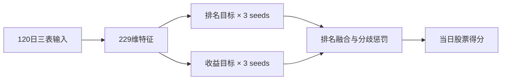

# CSI300 Dual-Target LightGBM

上海科技大学首届量化金融挑战赛参赛记录：从浅层树模型出发，逐步加入量价表示、市场截面特征、双目标训练和种子分歧惩罚。最终账户私榜第 **13** 名。

仓库公开 v10 的完整训练与推理代码、六份冻结权重，以及比赛期间的实验复盘。这是我作为大一新生第一次参加数据科学竞赛的记录。

| 记录 | RankIC | Information Ratio | Score |
| --- | ---: | ---: | ---: |
| v10 历史公榜 | 0.0817 | 4.6406 | 随标准化参考集合变化 |
| 账户最终私榜 · 第13名 | 0.0721 | 3.5702 | 0.6999 |

私榜来自赛后平台截图；版本与成绩的对应说明见[实验复盘](docs/research.md)。

## 模型

每天收盘后，模型对沪深300股票做下一交易周期的截面排序。监督标签为 `raw_open[t+2] / raw_open[t+1] - 1`，推理输入为截至信号日最近120个交易日的数据。

- 229维特征：124个截面排名通道，加105个量价与市场状态通道。
- 两个监督目标：未来H1收益的日截面排名，以及按日截面标准化、截断后的H1收益。
- 每个目标训练3个LightGBM，种子为42、43、44，每个模型350轮。
- 先对种子预测排名，再按75%/25%融合两个分支，并扣除固定的种子分歧项。



推理在CPU上运行。参数离线训练并固定，每次调用独立计算，`is_st`列不参与预测。完整公式和参数见[模型说明](docs/model.md)。

## 快速使用

使用Python 3.11，在仓库根目录执行：

```bash
python -m pip install -r requirements.txt
python scripts/verify_artifacts.py
python -m unittest discover -s tests -v
```

后两步不需要竞赛数据：先检查权重和源码指纹，再用虚构行情检查加载、输出格式、120日裁剪和无状态推理。

准备好符合[输入格式](docs/data_schema.md)的三张表后：

```python
from submission.inference import InferenceModel

model = InferenceModel("submission/model")
scores = model.predict(
    as_of_date="2022-12-30",
    data={
        "MarketData": market,
        "Factor33_winsor": factors,
        "Barra_factor": barra,
    },
)
# scores: date, code, score
```

原始行情需自行向组织方取得，仓库不打包数据。已有授权数据时，可在新目录重训：

```bash
python -m pip install -r requirements-training.txt
python submission/train.py --data-root ./data --cutoff 20221231 --variant confidence --out-dir artifacts/retrained
```

训练、回测与环境说明见[复现指南](docs/reproduction.md)。

## 研究与学习材料

| 内容 | 入口 |
| --- | --- |
| 特征、监督目标、融合公式和模型参数 | [模型说明](docs/model.md) |
| v2–v14版本史、失败实验与最终选择 | [实验复盘](docs/research.md) |
| 公榜反馈、年度费用与压力场景 | [机器可读结果](experiments/results.json) |
| 24篇Kaggle方案的阅读和实验对应 | [思路索引](docs/kaggle_ideas.md) |
| 股票、金融数据、机器学习与Python入门 | [学习手册](docs/learning_guide.md) |
| 从虚构行情到样本外评价的完整练习 | [合成数据脚本](examples/toy_pipeline.py) |
| 二十天资料的整理去向 | [资料索引](docs/archive_map.md) |

v8的主要进步来自特征表示，v9加入第二个监督目标，v10再加入种子分歧惩罚。后续也尝试了序列网络、风险残差目标、更多模型融合和近期叶值更新。新版本没有稳定超过v10，所以公开版本保留了这套结构简单、可检查的六模型方案。

感谢DataTech与TopK AI量化实验室组织比赛，也感谢Kaggle方案作者与开源项目提供的参考。发布结构参考了[冠军的公开仓库](https://github.com/Star6azeR/CSI300-Challenge-2026/)，具体方法来源列在[参考资料](docs/references.md)。

## 许可

本项目原创代码、文档及自训权重采用[MIT许可证](LICENSE)。第三方来源说明见[THIRD_PARTY_NOTICES.md](THIRD_PARTY_NOTICES.md)，竞赛数据保留其原有使用条款。
