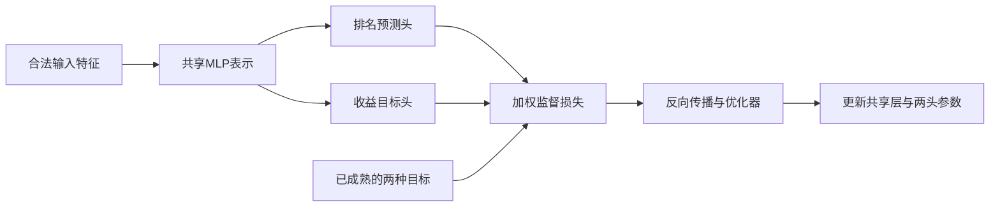

# 从零理解量化金融与机器学习

## 阅读目录

- [使用方法与学习地图](#使用方法与学习地图)
- [金融基础：先理解股票，再理解模型究竟在预测什么](#金融基础先理解股票再理解模型究竟在预测什么)
- [从指数到指数增强：比较的是相对于谁更好](#从指数到指数增强比较的是相对于谁更好)
- [读懂行情：一行数据不等于完整市场](#读懂行情一行数据不等于完整市场)
- [收益、复权与时间轴：标签正确才有后续讨论](#收益复权与时间轴标签正确才有后续讨论)
- [从股票得分到组合：排序正确还不够](#从股票得分到组合排序正确还不够)
- [指标教材：IC、RankIC、ICIR、IR、Sharpe 各自衡量什么](#指标教材icrankicicirirsharpe-各自衡量什么)
- [成本、换手与执行：毛收益怎样变成净收益](#成本换手与执行毛收益怎样变成净收益)
- [Barra、风险暴露与中性化：约束的意义与边界](#barra风险暴露与中性化约束的意义与边界)
- [分布、非平稳与选择偏差：金融机器学习为何难以照搬普通表格任务](#分布非平稳与选择偏差金融机器学习为何难以照搬普通表格任务)
- [数据与 Python：先让每一行有明确含义](#数据与-python先让每一行有明确含义)
- [机器学习从一个明确的问题开始](#机器学习从一个明确的问题开始)
- [监督、无监督、自监督：区别取决于训练信号](#监督无监督自监督区别取决于训练信号)
- [回归、分类和排序是在回答不同的问题](#回归分类和排序是在回答不同的问题)
- [数据切分与时间成熟，比模型结构更基础](#数据切分与时间成熟比模型结构更基础)
- [损失、梯度与训练过程：参数究竟怎样改变](#损失梯度与训练过程参数究竟怎样改变)
- [线性回归与 Ridge：简单模型的价值](#线性回归与-ridge简单模型的价值)
- [决策树、Bagging 与 Boosting](#决策树bagging-与-boosting)
- [LightGBM、XGBoost、CatBoost：库名不等于比赛结论](#lightgbmxgboostcatboost库名不等于比赛结论)
- [特征的数值表达：缩放、排名与缺失](#特征的数值表达缩放排名与缺失)
- [PyTorch是框架，MLP才是一类模型](#pytorch是框架mlp才是一类模型)
- [LSTM：用递归状态处理顺序](#lstm用递归状态处理顺序)
- [Transformer：注意力连接哪些信息](#transformer注意力连接哪些信息)
- [Mamba与选择性状态空间：记忆不只有注意力一种形式](#mamba与选择性状态空间记忆不只有注意力一种形式)
- [掩码、自监督与有监督预测头如何接起来](#掩码自监督与有监督预测头如何接起来)
- [已试过的高级机制：看清它改了哪一个环节](#已试过的高级机制看清它改了哪一个环节)
- [概率、收益分布与不确定性](#概率收益分布与不确定性)
- [集成学习与v10的真实公式](#集成学习与v10的真实公式)
- [离线训练、在线学习与离线叶值更新](#离线训练在线学习与离线叶值更新)
- [从模型原理到一份可信的实验记录](#从模型原理到一份可信的实验记录)
- [时间验证与过拟合：这次比赛最值得带走的方法](#时间验证与过拟合这次比赛最值得带走的方法)
- [代码、库与工程：把研究想法变成可运行的模型](#代码库与工程把研究想法变成可运行的模型)
- [使用论文、AI与本地决策模型的方法](#使用论文ai与本地决策模型的方法)
- [完整代码练习：从合成行情到样本外评价](#完整代码练习从合成行情到样本外评价)
- [必要数学小抄：读公式时每个符号代表什么](#必要数学小抄读公式时每个符号代表什么)
- [怎么继续学习：从能看懂到能独立复现](#怎么继续学习从能看懂到能独立复现)

## 使用方法与学习地图

这份手册面向第一次接触数据科学竞赛的学生。它把这次项目用到的金融、股票、统计、机器学习、代码与工程连接起来；涉及更高级方法时也解释它改变了什么、依赖什么条件，而不只给模型名字。

配套的[建模复盘](research.md)记录版本变化。手册初稿完成于2026年10月15日，10月20日整理为公开版；账户私榜第13名，RankIC 0.0721、IR 3.5702。本文从这次比赛用到的知识讲起。

本页可在GitHub或Obsidian中阅读。代码块分别解释单个步骤；“完整代码练习”提供可独立执行的脚本，也保存在[examples/toy_pipeline.py](../examples/toy_pipeline.py)。

文中的阶段编号用于对应比赛时的研究档案。正式源码见[submission](../submission/)，汇总结果见[experiments/results.json](../experiments/results.json)。

|阅读轮次|先看什么|应该能回答什么|
|---|---|---|
|第一轮|金融、行情、收益时间轴|股票是什么，为什么预测相对收益|
|第二轮|面板、清洗、标签、时间验证|这一行是否在预测时可得，答案何时成熟|
|第三轮|树、Ridge、神经网络、v10融合|模型怎样从损失中学习，六个模型如何输出一个分数|
|第四轮|完整代码、回测、工程与研究纪律|怎样运行、评价、部署和发现自己的错误|


> [!tip] 先建立三个概念边界
> 预测分数不等于已经成交的收益；训练合法不等于选择过程无偏；代码正确不等于未来一定有alpha。这三个边界贯穿整份手册。


## 金融基础：先理解股票，再理解模型究竟在预测什么

本章从公司股权讲起，再走到行情、收益、组合、指标、费用与风险模型。文中为了教学设置的甲公司、乙股票和账户数字，均为**虚构例子，不是本竞赛的真实样本或回测结果**。涉及本项目的定义，以本地赛题规则和实际读取的 SDK 源码为准；这里不推断隐藏评测年份、评分公式、私榜名次或最终人工审核结果。

建议先记住这条业务链：

$$
\text{公司与股票}\rightarrow\text{可观察数据}\rightarrow\text{股票得分}
\rightarrow\text{组合权重}\rightarrow\text{实际交易}\rightarrow\text{扣费后净值}.
$$

机器学习模型主要负责中间的“用当时已知数据产生股票得分”。它输出一个数，并不等于已经买入股票，也不等于账户能够兑现对应收益。后续还要经过权重限制、成交限制、费用和持仓记账。本竞赛由组织方统一完成组合构建与回测，选手提交模型推理包。本项目赛题说明（本地研究档案）

### 1. 股票、股权与公司：买到的是一份权益

股票代表公司股权的一部分。股东可能通过公司分红或股票价格变化获得收益，也承担经营恶化、估值下降等风险；持有股票不是公司承诺按时付息还本的借款关系。普通股股东的分红、表决等权益还受到公司章程、股份类别和适用法律的约束。[美国 SEC 投资者教育：股票基础](https://www.investor.gov/introduction-investing/investing-basics/investment-products/stocks)

假设甲公司共有 1 亿股，你拥有 1 万股，那么股数口径的持股比例是：

$$
\frac{10\,000}{100\,000\,000}=0.0001=0.01\%.
$$

这并不意味着你可以直接取走公司仓库里 0.01% 的货物。公司拥有自己的资产、负债和经营活动；股东拥有的是对公司的权益。公司经营赚了钱，也不一定马上全部分红，可能保留利润用于投资、偿债或补充现金。

理解股价时，要分清三个层次：

- **经营层面：** 公司生产什么、销售多少、利润和现金流如何。
- **权益层面：** 股份总数、持股比例、分红及其他股东安排。
- **市场层面：** 买卖双方目前愿意用什么价格交换这些股份。

三者相互关联，但不会逐日同步。业绩较好的公司也可能因为市场原本预期更高而下跌；短期股价上涨也不等于经营质量立即改善。模型看到的价格，是市场交易形成的结果，不是公司“真实价值”的直接读数。

### 2. IPO、增发与二级市场：钱到底流向谁

IPO 是 Initial Public Offering，即首次公开发行。理解这个概念，关键不是背英文，而是区分**发行融资**和**投资者之间交易**。

假设甲公司原有 1 亿股，以每股 8 元新发行 2,500 万股。暂不考虑发行费用，新股融资额是 2 亿元，发行后总股数为 1.25 亿股。原来持有 1,000 万股的股东，股数不变，持股比例却由 10% 变为 8%。这叫持股比例被摊薄。不过，公司同时获得了融资，不能仅凭比例下降就断定原股东的经济价值同比例下降。

上市后的普通二级市场交易则不同：你花钱从另一位投资者手里买股票，款项通常付给卖方，而不是每一笔都直接进入公司账户。公司的融资行为与交易所里持续发生的股票买卖，是两种不同活动。

对本竞赛而言，模型通常不需要预测 IPO 发行定价，但应理解上市时间、可交易股份、融资或公司行动可能影响数据。不能因为当前能查到一项公司信息，就认定它在历史每一天都已公开。上市状态和财务信息也要遵守时间可得性。

### 3. 股价、市值、流通市值：价格低不等于公司便宜

设股票价格为 $P$，总股本为 $N$，最基本的总市值计算是：

$$
\text{总市值}=P\times N.
$$

例如，甲公司每股 10 元、总股本 1 亿股，总市值为 10 亿元；乙公司每股 100 元、总股本 100 万股，总市值只有 1 亿元。乙公司的股价更高，公司的市场权益总价值却更小。

“某股票只要 5 元，因此比 100 元股票便宜”是常见误解。每股价格受到股份切分方式影响。判断估值还需要结合利润、净资产、现金流等。市盈率 $PE=P/EPS$ 可以理解为每股价格除以每股盈利，但当盈利为负、接近零或存在一次性项目时，PE 可能很难解释；不能机械地认为数字越小越好。

如果能在市场流通的股份为 $N_{\text{tradable}}$，相应的流通市值通常可写成：

$$
\text{流通市值}=P\times N_{\text{tradable}}.
$$

它与指数编制中的“自由流通调整市值”不是必然相同的字段。后者可能涉及对长期战略持股、可投资性或调整比例的专门定义。做研究时必须读字段说明，不能只看中文名字就把两者互换。

一个十分直观的检验是拆股：假设每 1 股拆成 2 股，股份数量翻倍，理论上每股价格减半。忽略其他因素，$P\times N$ 不变。这说明**一股的面额切分不等于公司财富凭空变化**。同样，不同公司的股价不能像同规格商品的单价那样直接比较。

本项目有总市值、流通市值、估值等特征。模型可以学习它们与未来相对表现的统计关系，但特征名不是投资结论；“市值因子有用”也不代表“小公司永远更好”。

### 4. 行业：股票之间为什么会一起波动

行业把经营活动相近的公司归到同一组。例如银行、食品饮料、医药等公司面对的盈利来源、监管环境和成本结构不同。同一行业股票可能同时受到利率、原材料价格或需求变化影响。

假设今天模型选出的前 20 只股票里，有 15 只是同一行业。明天这个行业整体上涨，组合看起来表现很好，但这种收益可能主要来自行业押注，而不是模型在同行业里识别了更好的公司。若行业下跌，集中持仓也可能共同受损。

行业分类并非永远不变：公司主营业务可能变化，不同分类体系的粒度和归属规则也不同。本竞赛按历史时点提供行业信息。正确做法是使用当时对应的数据，不能用今天的行业标签或今天的指数成分表反推全部过去。本项目 Point-in-Time 规则（本地研究档案）

## 从指数到指数增强：比较的是相对于谁更好

### 5. 指数是什么，沪深 300 为什么成为基准

股票指数按照事先制定的方法，把一组股票的价格或收益汇总为一个数字。指数点位不是某只股票的价格，也不是说投资 3,000 元就必然能买到“3,000 点”的实物。不同指数使用不同的样本、权重、调整和公司行动处理方法。

本赛题以沪深 300 历史成分股为研究对象，并提供历史基准权重。这里最重要的概念是：**成分股会随时间变化，权重也不一定相等**。本项目研究应以给定历史成分状态和权重为准，不自行用现在的 300 只股票覆盖过去。本地赛题 Data 与 Overview（本地研究档案）

如果一个三只股票的教学指数权重为 50%、30%、20%，对应单期收益为 2%、−1%、1%，忽略调整和费用，它的单期收益是：

$$
r_b=0.5\times2\%+0.3\times(-1\%)+0.2\times1\%=0.9\%.
$$

把三只股票收益简单平均，得到的却是约 0.67%，与该基准不同。真实回测中的权重时间、公司行动和指数收益口径还需要单独核对。指数的价格收益与包含分红再投资的总收益也应区别，不能只因为名字都写“沪深 300”就当成同一条收益序列。

### 6. 指数增强：可以在下跌市场中“增强”，也可能仍然亏钱

被动跟踪希望组合尽量贴近基准；指数增强希望在控制偏离的前提下获得更好的收益。设组合收益为 $r_p$、基准收益为 $r_b$，最常用的单期主动收益是：

$$
a=r_p-r_b.
$$

若基准跌 10%，组合跌 8%，主动收益为 $+2$ 个百分点。相对基准做得更好，但账户仍然亏了 8%。反过来，基准涨 10%、组合涨 8%，账户赚钱了，主动收益却为负。

指数增强并非“保证正收益”的策略。它需要回答两个不同的问题：

1. 相对于基准，多赚了多少或少亏了多少？
2. 为了这些差异，承担了多少额外波动、集中风险和交易成本？

因此，本项目既关注股票排序能力，也关注统一优化后的组合 IR。只看指数大涨时期组合赚了钱，很难识别模型是否提供了真正的增强能力。

### 7. 超配、低配与主动权重：低配不等于做空

设基准权重向量为 $b$，组合权重为 $w$，主动权重为：

$$
\Delta w=w-b.
$$

假设某股票在基准中占 4%，组合中占 3%，它的主动权重为 −1 个百分点。组合仍持有该股票，只是持有得比基准少，这叫低配；它不是卖空。

若组合与基准都完全投资于相同资产集合，则 $\sum_iw_i=\sum_ib_i=1$，因而 $\sum_i\Delta w_i=0$。这意味着增加某些股票的相对配置，通常要减少另一些股票的相对配置。增强是在一组约束下重新分配，而不是把“看好”的股票全部无限加仓。

短期内，忽略费用与权重漂移时，组合主动收益可以近似理解为：

$$
a\approx\sum_i(w_i-b_i)r_i=\Delta w^\top r.
$$

真正记账仍应使用交易、持仓和基准净值，因为实际权重会漂移，现金和成交失败也会影响结果。本项目 SDK 直接记录 `portfolio_return`、`benchmark_return` 与两者之差 `active_return`。[实际记账源码](https://github.com/HenryZ16/skd-backtest)

## 读懂行情：一行数据不等于完整市场

### 8. OHLC：四个价格分别回答什么问题

OHLC 是 Open、High、Low、Close 的缩写：

| 字段 | 通常含义 | 可以回答的问题 | 不能直接推出的结论 |
|---|---|---|---|
| Open，开盘价 | 当日开盘对应的价格 | 从上一交易阶段进入今天时价格在哪里 | 不是所有人都能以无限数量成交的价格 |
| High，最高价 | 该统计区间的最高成交价格 | 当日曾经到过多高 | 不能事后假设自己恰好卖在最高点 |
| Low，最低价 | 该统计区间的最低成交价格 | 当日曾经到过多低 | 不能事后假设自己恰好买在最低点 |
| Close，收盘价 | 当日收盘对应的价格 | 当天结束时的定价状态 | 使用它产生信号后，不能回到过去按它建仓 |

例如，一天的 O/H/L/C 是 10/11/9.8/10.5。这四个数字并不告诉你先涨到 11 元再跌到 9.8 元，还是先跌后涨；它们也不包含每笔成交数量。很多日内执行细节无法从日线恢复。

因此，从日线数据构造“当天最低买入、最高卖出”的回测，通常是在利用事后信息。日线适合研究日频状态和收益，不代表能够重建盘口队列、逐笔撮合或开盘可成交容量。

### 9. Volume 与 Amount：成交量、成交额与计量单位

Volume 通常是成交数量；Amount 通常是成交金额。如果逐笔成交价格为 $p_j$、股数为 $q_j$，则：

$$
V=\sum_jq_j,\qquad A=\sum_jp_jq_j.
$$

但实际数据的 Volume 可能按“股”或“手”计量，Amount 可能按“元”“千元”或其他单位计量。导入数据时必须查字段单位，不能因为列名相同就直接相除。

例如，某天成交 1,000 股，每股均价 10 元，成交额为 10,000 元。若数据把成交量记为 10 手，直接用 $10,000/10$ 得到 1,000，并不是每股 1,000 元，而是漏掉了手与股的转换。对不同证券，交易单位还可能不同，不能把一个乘数无条件用于所有资产。

本项目的成交量、成交额属于量价特征。它们常用于刻画交易活跃程度，但“成交量大”不等于“成交一定容易”，因为还要看价差、冲击、市场状态和计划交易金额。

### 10. VWAP：成交额除以成交量，为什么还要谨慎

成交量加权平均价为：

$$
\operatorname{VWAP}=\frac{\sum_jp_jq_j}{\sum_jq_j}.
$$

假设上午以 10 元成交 100 股，下午以 12 元成交 900 股，简单平均价格是 11 元，而 VWAP 是：

$$
\frac{10\times100+12\times900}{1,000}=11.8\text{ 元}.
$$

大量交易发生在 12 元附近，因此成交量加权均价更接近 12 元。如果 Amount 和 Volume 覆盖同样的成交范围、口径和正确单位，$A/V$ 可以得到相应平均价；若二者统计范围不同或进行了不一致的调整，则不能机械解释为 VWAP。

VWAP 是已经发生交易的汇总价格，不是随时可以成交的报价。全天 VWAP 只有全天结束后才完整可得；如果模型在开盘时就使用当天完整成交额与成交量，会泄露未来。在本竞赛“t 日收盘后出信号”的设定下，t 日完整日线可以作为历史输入，但 t+1 日全天 VWAP 不可提前使用。

### 11. 换手率、成交额与流动性不是同一个东西

单只股票行情中常见的“换手率”可按成交数量除以某种流通股本计算，但分母具体采用什么股份口径，要看数据提供方定义。它表示交易活跃程度的一种比例，不等同于组合换手率。

流动性更关注“在多长时间内、付出多大价格代价，可以完成一定规模的交易”。它至少与价差、可交易深度、成交速度和价格冲击有关。日成交额是流动性的粗略代理，不是完整描述。

例如，日成交额 1 亿元的股票，对交易 1 万元与交易 5,000 万元的账户并不具有同样的可执行性。后者可能显著改变成交价格。日频数据无法直接给出真实市场冲击曲线，所以本项目的固定 slippage 压力场景只是约定的执行损耗测试，不是精确的冲击模型。

### 12. 停牌、无效价格与交易日历：缺一行并不等于零收益

股票某天没有数据，可能因为停牌、不在当期股票池、数据缺失或读取问题。这些情况的经济含义不同。把缺失价格填成零，会产生虚假的 −100% 收益；把缺失收益直接填成零，也可能错误地把无法交易或无法计算标签的样本当成正常样本。

交易日还不同于自然日。“下一日”通常应指下一交易日。星期五之后的下一交易日可能是星期一，遇到节假日还会更晚。某只股票连续出现的两行，也未必就是相邻的两个市场交易日，因为中间可能缺少记录。

本项目的历史窗口是最多 120 个**交易日期**，不是 120 个自然日或每只股票最近 120 条任意记录。处理滚动收益时，需要核对全市场日历与每只股票的有效观测；缺口的处理必须在训练与推理中一致。规则中的历史窗口要求（本地研究档案）

## 收益、复权与时间轴：标签正确才有后续讨论

### 13. 简单收益：把价格变化换成可比较的比例

从起点价格 $P_0$ 到终点价格 $P_1$ 的简单价格收益为：

$$
r=\frac{P_1-P_0}{P_0}=\frac{P_1}{P_0}-1.
$$

10 元涨到 10.5 元，收益是 5%；100 元涨到 105 元，同样是 5%。相对于绝对涨跌金额，收益比例更适合比较不同价格水平的股票。

如果持有期间获得现金分红 $D$，在不考虑费用、税收与复杂公司行动的简化情形下，经济总收益应包含这部分现金：

$$
r_{\text{total}}=\frac{P_1+D-P_0}{P_0}.
$$

所以“价格没涨”与“投资者没有获得收益”并不完全相同；反过来，买卖产生的费用也会使账户收益低于单纯的价格涨幅。

### 14. 对数收益：便于跨时间相加，但不是普通收益本身

当价格为正且 $r>-1$ 时，对数收益定义为：

$$
\ell=\log\frac{P_1}{P_0}=\log(1+r).
$$

小幅波动时，$\log(1+r)\approx r$；幅度变大后，两者差异明显。例如简单收益 10% 对应对数收益约 9.53%，不能把它们当作完全相同的数值。

对数收益的优点是跨时间可加：

$$
\log\frac{P_2}{P_0}=\log\frac{P_1}{P_0}+\log\frac{P_2}{P_1}.
$$

但跨股票的组合收益，通常是简单收益按持仓权重加权，而不是把各股票对数收益直接加权后当成组合简单收益。时间维度与截面维度的运算规则必须分开。

### 15. 复利：涨 10% 再跌 10%，为什么回不到原点

多期净值满足：

$$
N_T=N_0\prod_{t=1}^T(1+r_t).
$$

从 100 元开始，先涨 10% 变为 110 元，再跌 10% 变为 99 元，两期合计亏 1%。简单收益的算术和为零，却不能代表最终收益为零。

如果亏损比例为 $d$，恢复原值需要的涨幅是：

$$
\frac{1}{1-d}-1=\frac{d}{1-d}.
$$

亏 20% 后需要涨 25% 才能回本；亏 50% 后需要涨 100%。风险控制不仅影响当期感受，也影响资本未来复利的起点。

年化收益也不能一律用“平均日收益乘交易日数”代替。在本项目读取的 SDK 中，净值起点为 1，若实际有 $T$ 个记账交易日、年交易日数设为 $A$，组合年化复利收益为：

$$
R_{p,ann}=N_{p,T}^{A/T}-1.
$$

本地固定场景使用 $A=252$。这是一种年化约定，不代表每个真实年份恰好有 252 个交易日，也不等于从少量天数外推未来一定能赚到同样年化收益。[SDK 年化收益定义](https://github.com/HenryZ16/skd-backtest)

### 16. 除权除息与复权：价格跳变可能不是财富等比例消失

股票分红、送转、拆并股等公司行动可能改变每股价格和股份数量。最简单的例子是 1 股拆成 2 股：价格从 20 元变成约 10 元，持有股数翻倍。若只看未调整价格，似乎亏了一半；但股数与价格共同决定的持仓价值并没有因此减半。

现金分红也类似。假设除息前股票 10 元，每股分红 1 元，除息后理论参考价格为 9 元。忽略市场波动、税费等，原股东持有约 9 元的股票加 1 元现金，总经济价值仍约 10 元。真实开盘价格还会受到当日供需影响，不必恰好等于理论参考价。

复权价格通过一定方法调整历史价格，使时间序列更适合比较公司行动前后的经济变化。常见的前复权、后复权只是不同展示基点；**复权序列是计算工具，不是交易所当时可成交的真实报价**。调整方法是否包括现金分红、配股和其他行动，也要看数据定义。

一个基本的数据检查是：同一段收益的分子和分母必须采用一致口径。不能用复权后的终点价格除以未复权的起点价格，也不能把复权价格当作原始成交价去计算真实股数，再重复计入分红。

### 17. 本项目最关键的区分：raw 标签与 adjusted_return 账户

本赛题明确采用信号日之后的单日 open-to-open 预测目标：

$$
y_{i,t}=\frac{O^{raw}_{i,t+2}}{O^{raw}_{i,t+1}}-1.
$$

这定义了排序评价的未来结果。与此同时，本项目后期本地回放固定使用 `price_mode='adjusted_return'` 进行账户估值。SDK 在该模式下，按调整后价格相对持仓参考价格的比例更新持仓价值；它不是简单地拿 raw 股数乘 adjusted 价格。赛题目标（本地研究档案）、[SDK 持仓估值实现](https://github.com/HenryZ16/skd-backtest)、本地场景明确配置（本地研究档案）

因此，必须分开理解：

| 问题 | 本项目对应口径 |
|---|---|
| 股票排序是否正确 | raw-open H1 标签与预测 score 的截面排序相关 |
| 持仓价值怎样变化 | 本地回放使用 adjusted-return 账户记账 |
| 最后净赚多少 | 持仓价格变化、实际交易、现金与费用共同决定 |

公司行动附近，这两种收益定义可能不完全相同。指出差异不等于宣布赛题标签错误，也不意味着能擅自替换官方评价目标。研究者需要把“贴合官方预测标签”与“有利于组合经济收益”分别验证。

还要区分**单只股票的标签区间**与**账户净值的记账时点**：模型的 H1 标签是两个未来开盘价之比，账户日净值则按 SDK 的日内交易和估值过程生成。不能直接把所有 H1 标签平均后，声称复现了净值曲线。

### 18. t、t+1、t+2：收盘后产生的信号不能穿越到收盘前交易

本赛题固定时间轴是：

$$
t\text{ 日收盘观察数据}\rightarrow\text{生成得分}
\rightarrow(t+1)\text{ 日开盘调仓}
\rightarrow(t+2)\text{ 日开盘进入下一次调仓}.
$$

例如，星期一收盘后计算信号，假设后续都正常开市，则星期二开盘建仓，预测的是星期二开盘到星期三开盘的相对表现。星期一开盘到星期一收盘的涨跌已经发生，可以作为特征，不能再当成这次信号能够赚到的未来收益。

假设星期二开盘 10 元、星期三开盘 10.2 元，那么星期一信号对应的 H1 标签是 2%。星期一收盘价即使是 9.8 元，也不应拿来充当这笔未来开盘交易的买入价。

训练截止边界同样重要。如果训练只允许使用截至某天已知的信息，一个样本虽然信号日较早，但它的 $t+2$ 开盘还未发生，那么该标签尚未成熟。**未来结果未成熟的样本不能进入该时点训练。** 这与输入特征是否缺失是不同条件。

### 19. Point-in-Time：报告期与知道它的日期不是一回事

某公司 2020 年年报描述的是 2020 年经营情况，但报告可能在 2021 年才公布。研究 2020 年 12 月某天的决策时，不能因为列名写着“2020 年利润”，就认定该数值当时可用。

可以把每项信息想成至少有两个时间：

- **它描述的经济时期：** 例如财报对应的季度。
- **市场能够获得它的时间：** 例如公开披露并进入数据系统的日期。

机器学习特征必须服从第二个时间的约束。修订后的财报、后来才确认的指数成分调整、未来才发布的风险暴露，也不能无条件回填到更早历史。本竞赛说明数据按照 Point-in-Time 原则提供，但研究者自己构造的标准化、筛选和关联操作仍然可能引入未来信息。Point-in-Time 规则全文（本地研究档案）

## 从股票得分到组合：排序正确还不够

### 20. 得分不是收益承诺，排名也不是买入金额

模型输出 $s_{i,t}=0.8$，不表示明天赚 80%，也不必表示上涨概率为 80%。它可能是树模型的回归输出、神经网络的未经校准分数，或多个模型的排名组合。分数的含义必须由训练目标和后处理来定义。

例如，三只股票得分为 0.1、0.3、0.7，乘以 100 后变成 10、30、70，排序没有变化。对严格依赖排序的指标，两组结果相同；但若优化器把原始数值直接当预期收益使用，缩放可能改变风险收益权衡。必须检查具体实现，不能假设所有优化器都只看顺序。

本项目读取的 SDK 组合构建会计算带并列处理的 score 百分位；Barra 分支在此基础上寻找满足约束的权重。因此应以实际优化器源码解释分数如何参与权重计算，而不是根据“score”这个名字猜测。[得分排序与百分位实现](https://github.com/HenryZ16/skd-backtest)

### 21. 多头、空头、净敞口与总敞口

多头最容易理解：买入股票，价格上涨时持仓增值。空头的简化经济含义是通过借入并卖出等机制建立反向头寸，价格下跌时可能获利；实际还涉及可借数量、借券费用、保证金、召回和交易限制，不能在股票表中写一个负权重就假定真实世界总能成交。

对权重向量 $w$，常见的净敞口和总敞口分别为：

$$
\text{净敞口}=\sum_iw_i,\qquad
\text{总敞口}=\sum_i|w_i|.
$$

一个组合多头 100%、空头 100%，净敞口为零，总敞口为 200%。它不等于“没有风险”：多头可能跌、空头可能涨，风格或行业也可能不平衡。净资金接近零与收益波动接近零是两件事。

本地统一对照采用 long-only，即 $w_i\ge0$，并要求目标组合 fully invested，即目标权重合计为 1。低分股票主要通过少配或不配表达，而不是自动建立空头。这些是组合目标约束；实际成交受费用和交易可行性影响，账户仍可能有现金。[SDK 优化配置](https://github.com/HenryZ16/skd-backtest)

### 22. 权重漂移与再平衡：不交易，比例也会改变

假设账户最初甲乙各占 50%。一天后甲上涨 10%，乙不变。暂不考虑费用，甲价值从 50 变为 55，乙仍为 50，甲的实际权重变为 $55/105\approx52.38\%$。

因此，再次将目标设为各 50%，也需要卖出一点甲、买入一点乙。组合换手不是简单比较今天与昨天写在模型输出里的目标向量；更准确的比较对象是**今天调仓前、已经随价格变化的实际持仓**。

另一个常见误解是“每天调仓等于每天全部卖光再买入”。本赛题明确由系统根据相邻组合的差异执行必要交易，不要求每日全仓清空。若目标基本相同，往往只需少量调整。赛题每日调仓说明（本地研究档案）

### 23. 绝对风险、主动风险与系统性风险

绝对风险通常关注账户自身可能怎样波动或损失；主动风险关注相对于基准的偏离。一个完全跟踪指数的组合，可能有很大的市场波动，但主动收益很接近零，跟踪误差很小。

系统性风险是许多股票共同受到的因素影响，例如市场整体、行业和某些风格。个股特异性风险则更接近公司独有事件，例如单家公司经营意外。两者的区分依赖模型，不是客观上完全固定的分类。

分散持股往往能降低一部分个股特异性波动，但不能保证消除整体市场风险。持有 50 只高度相似的股票，未必比持有 20 只风险来源更分散的股票更稳健。风险不能只靠“股票数量多”来判断。

## 指标教材：IC、RankIC、ICIR、IR、Sharpe 各自衡量什么

### 24. 截面相关性：一天内比较多只股票

在交易日 $t$，我们同时拥有多只股票的预测得分 $s_{i,t}$ 和未来标签 $y_{i,t}$。截面相关性衡量的是：**这一天得分较高的股票，未来收益是否也相对较高。** 它不是“同一只股票过去几年预测对了多少次”。

Pearson IC 常写为：

$$
IC_t=\operatorname{Corr}_{i}(s_{i,t},y_{i,t})
=\frac{\sum_i(s_{i,t}-\bar s_t)(y_{i,t}-\bar y_t)}
{\sqrt{\sum_i(s_{i,t}-\bar s_t)^2\sum_i(y_{i,t}-\bar y_t)^2}}.
$$

它刻画线性关系，对极端数值和预测尺度形状相对敏感。比如一只股票的收益特别极端，可能明显影响当日 Pearson 相关性。

如果所有股票得分相同，分数没有截面变化，分母为零，相关系数没有正常定义。这不应被解释为“预测非常稳定”；它意味着模型没有提供可区分的排序信息。

### 25. RankIC：先排名，再算相关性

Spearman RankIC 可以理解为对预测得分与真实收益分别取排名，再计算 Pearson 相关性：

$$
RankIC_t=\operatorname{Corr}_i
\big(\operatorname{rank}(s_{i,t}),\operatorname{rank}(y_{i,t})\big).
$$

没有并列名次时，也可以写成：

$$
\rho=1-\frac{6\sum_id_i^2}{n(n^2-1)},
$$

其中 $d_i$ 是同一股票两个名次之差。遇到并列时，应使用适当的并列排名处理，而不是直接套无并列公式。

例如，甲乙丙的预测名次为 1、2、3，真实名次为 1、3、2。名次差为 0、−1、1，平方和为 2，因此 RankIC 为 $1-12/24=0.5$。如果完全同序则为 1，完全反序则为 −1。

RankIC 不关心分数是 0.1/0.2/0.9，还是 1/2/100，只要排序相同且没有改变并列关系，它们的 RankIC 相同。严格递增变换保持顺序；但四舍五入、分箱或强裁剪可能制造并列，从而改变 RankIC。

本赛题本地推荐的预测指标是每日截面 RankIC，再对日期求平均。即使报告或公榜把列名简写成“IC”，解释时也应先确认它实际采用 Pearson 还是 Spearman，而不要混用名称。赛题 Local Development 指标定义（本地研究档案）

SDK 还有应当单独记录的边界约定：先保留 score 与标签都为有限值的交集，再用平均名次处理并列。有效股票少于 2 只时，RankIC 不可用；有效股票至少 2 只但所有预测分数相同时，代码特别记为 0；预测有变化而真实收益全相同时，则仍不可用。数学相关系数的分母为零与程序返回什么值，是两个层次；复算必须尊重这个特判，不能自行统一填零。[SDK 截面评价源码](https://github.com/HenryZ16/skd-backtest)

### 26. 正 RankIC 不等于所有股票都上涨，也不等于每笔交易赚钱

假设三只股票都下跌，收益为 −1%、−3%、−5%。模型把 −1% 的股票排最高，把 −5% 的排最低，排序可以完全正确。但如果组合仍然满仓多头，账户可能继续亏钱，只是相对基准可能少亏。

反过来，如果三只股票都上涨 5%、3%、1%，把它们顺序排反仍可能在绝对金额上赚钱，但模型相对选股能力很差。

RankIC=0.08 也不是“8% 胜率”“预测对 8% 股票”或“每天赚 8%”。相关系数没有这些含义。它是跨股票的统计关系强度；从它到组合收益，还隔着持仓、风险约束、收益幅度和交易费用。

### 27. 平均 RankIC、RankIC 标准差与正值比例

有 $T$ 个有效交易日时，平均 RankIC 为：

$$
\overline{IC}=\frac1T\sum_{t=1}^TIC_t.
$$

这里的 $IC_t$ 可特指每日 RankIC。标准差描述不同日期之间相关性的波动；正值比例则是有效日期中 $IC_t>0$ 的比例。

三者不是同一个结论。模型可能少数日期很强、其余日期较弱，得到不错的平均值；也可能多数日期略正、偶尔极负，正值比例看起来较高但均值不佳。因此，应共同阅读，而不是只挑最好看的一个数字。

还要明确日期权重：先逐日计算再等权平均，与把所有 date×stock 行拼在一起算一次相关性不同。后者会混合跨日尺度，也可能让股票数量较多的日期获得更大隐含权重。

### 28. ICIR 与 RankICIR：预测能力随日期变化的稳定程度

一种常用定义是：

$$
ICIR=\frac{\text{每日 IC 的平均值}}{\text{每日 IC 的标准差}}.
$$

若分子来自 RankIC，通常称 RankICIR。本项目读取的 SDK 正是 `mean_rankic / rankic_std`，其中标准差用样本标准差、分母为 $T-1$，**该字段不乘 $\sqrt{252}$，即不年化**。若有效样本不足或标准差为零，结果可能为 `None`，不是无限大或“零风险”。[SDK RankICIR 实现](https://github.com/HenryZ16/skd-backtest)

教学例子：两个模型平均 RankIC 都为 0.04。甲的日度标准差为 0.08，RankICIR=0.5；乙为 0.16，RankICIR=0.25。这只能说明按该统计量，甲的日度相关性相对更稳定，不能直接断定甲的交易账户 IR 一定更高。

某些资料会使用年化 ICIR。因此比较不同报告时，必须问清是否乘年化因子、标准差口径、样本频率和有效日期。一个年化数字与一个不年化数字直接比较，可能相差十几倍却没有实际优劣差别。

### 29. 跟踪误差与组合信息比率 IR

对每日主动收益 $a_t=r_{p,t}-r_{b,t}$，跟踪误差常定义为主动收益标准差的年化值：

$$
TE=\operatorname{Std}_{sample}(a_t)\sqrt A.
$$

注意这里使用的是**超额收益的波动**，不是组合自身收益的波动。一只跟踪指数很紧的组合，绝对波动可以较大，TE 却很小。

通用教材中，IR 常表示年化平均主动收益除以年化跟踪误差。但本项目 SDK 的精确定义是：

$$
IR_{SDK}=\frac{R_{p,ann}-R_{b,ann}}{TE},
\qquad
R_{b,ann}=N_{b,T}^{A/T}-1.
$$

分子是**组合 CAGR 与基准 CAGR 的差**，不是 $A\cdot\overline a$，也不是 $\left(N_{p,T}/N_{b,T}\right)^{A/T}-1$。小收益、较短波动环境下这些数值可能接近，但不是恒等式。复算本项目报告时必须采用实际定义。[SDK 组合 IR 与年化超额收益实现](https://github.com/HenryZ16/skd-backtest)

例如，组合年化收益为 12%，基准年化收益为 8%，TE 为 4%，SDK IR 为 $(12\%-8\%)/4\%=1$。分子分母都应使用小数或都使用百分数；若一个写 0.04、另一个写 4，就会制造 100 倍误差。

### 30. Sharpe：参照无风险收益，不是参照沪深 300

Sharpe ratio 通常衡量超出无风险收益的平均收益，相对于自身波动有多大。SDK 先将年无风险收益率 $r_f$ 换算为日无风险收益：

$$
r_{f,d}=(1+r_f)^{1/A}-1,
$$

再计算：

$$
Sharpe_{SDK}=\frac{\operatorname{Mean}(r_{p,t}-r_{f,d})}
{\operatorname{Std}_{sample}(r_{p,t}-r_{f,d})}\sqrt A.
$$

这里使用日度算术均值，而 SDK 的 IR 分子使用两条净值的年化复利收益之差。不能为了公式“看起来统一”而修改其中一个。本地固定场景的年无风险收益率设为 0，只是一项回测设置，不代表现实无风险收益永远为零。[SDK Sharpe 定义](https://github.com/HenryZ16/skd-backtest)

一个组合可能 Sharpe 较高，却持续落后于更强的基准，IR 较低；也可能绝对收益不佳，但相对基准更稳健。评价指数增强，应先确认自己问的是绝对投资表现还是相对基准表现。

### 31. 最大回撤：从曾经达到的高点，最深跌下去多少

设净值为 $N_t$，此前最高净值为 $H_t=\max_{u\le t}N_u$，则回撤幅度可写成：

$$
DD_t=1-\frac{N_t}{H_t},\qquad
MDD=\max_tDD_t.
$$

假设净值从 1 升到 1.2，再跌到 0.9，之后回到 1.1。从 1.2 到 0.9 的回撤是 25%，即使最终净值仍高于初始值，过程中的最大回撤依然存在。

SDK 以初始净值 1 作为起始高点，并输出非负的最大回撤幅度。有些平台把回撤记成负数，比较时要先统一符号。本项目的 `maximum_drawdown` 是组合自身净值的回撤，不能直接当成相对基准净值的最大回撤。[SDK 回撤函数](https://github.com/HenryZ16/skd-backtest)

波动率与回撤也不相同。标准差不区分上涨和下跌；最大回撤则依赖收益发生的顺序。一组相同的日收益换一种排列，可以有相同均值和标准差，却产生不同回撤路径。

### 32. 为什么 IC 更高，组合 IR 反而可能更低

至少有以下几条路径：

1. 全截面的排序改善，可能主要发生在不影响组合权重的中间股票；前列股票反而没改善。
2. 高分股票的预期收益优势较小，但组合为了追它们产生较大交易成本。
3. 得分集中在某个行业或风格，经过约束后，能够保留的有效主动权重很小。
4. 模型预测能力在日期间不稳定，少数不利时期贡献了较大主动波动。
5. raw 排序标签与账户实际经济收益并非处处完全一致。
6. 停牌、涨跌停、现金约束或订单失败，使目标权重不能完全实现。

因此，预测指标与组合指标都重要，但用途不同：前者帮助判断信号是否含有横截面信息；后者检验这种信息在统一约束和费用下能否转化为有效账户结果。不能从一个指标的提升演绎出另一个必然提升。

## 成本、换手与执行：毛收益怎样变成净收益

### 33. 佣金、税费、价差、滑点和冲击成本

**佣金**是交易服务相关收费；**税费**取决于适用市场和时期；**买卖价差**是同时刻最优买价与卖价的差异；**滑点**是实际执行相对于参考价格的不利偏移；**市场冲击**是自己的交易影响了市场价格。这些概念可能在某些模型中合并计算，但不能在同一回放里不加区分地重复扣除。

比如，买入参考价格 10 元，实际成交 10.005 元，即使账单上没有单独叫“滑点费”的项目，账户已经通过更高买入价格承担了损耗。卖出时则相反：参考价格 10 元，执行价格 9.995 元，同样不利。

日频回测往往无法精确重建盘口，因此需要声明近似方式。若成本模型没有模拟排队、冲击、交易容量或借券费用，就不能把结果称作对所有真实交易摩擦的完整复现。

### 34. bp 是什么：很小的百分数，反复发生也会很大

1 个基点 basis point，缩写 bp，等于：

$$
1\,bp=0.01\%=0.0001.
$$

所以 3bp=0.03%=0.0003，5bp=0.05%=0.0005，10bp=0.1%=0.001。把 3bp 写成 3% 会高出 100 倍。

本项目后期本地研究场景明确设置：佣金每边 3bp、卖出税假设 10bp、最低佣金与过户费为零；slippage 压力场景另加每边 5bp 的不利执行价偏移。这些是**锁定的实验假设，不是对 2026 年当前中国证券税费法规、券商报价或官方隐藏评测费用的宣称**。税率和交易规则在现实中可能调整，实际交易必须另查相应日期、证券类别与正式规定。实际本地场景配置（本地研究档案）

假设参考成交额买入、卖出各 10 万元，忽略价格变化和二阶细节，3bp 买佣金约 30 元，3bp 卖佣金约 30 元，10bp 卖税约 100 元，显式费用合计约 160 元。若另加双边各 5bp 滑点，又约损失 100 元执行价值。实际精确金额由 SDK 对实际成交额和执行价格逐笔计算，不能拿这个近似例子替代账本。

### 35. 组合换手率：一定要先问单边还是双边

设调仓前实际权重为 $w^{pre}$、目标权重为 $w^{tar}$，一种常见双边换手近似为：

$$
TO^{two}=\sum_i|w_i^{tar}-w_i^{pre}|.
$$

有些报告使用其一半作为单边换手。如果从 100% 甲股票完全切换到 100% 乙股票，卖出 100%、买入 100%，双边换手为 200%，半口径为 100%。两个数字都可能在不同定义下成立，必须先核对口径。

SDK 实际记录的是：

$$
TO_t=\frac{\text{当日实际成交金额总和}}{\text{当日开盘调仓前组合权益}}.
$$

随后将每日换手求和，得到指标 `turnover`，控制台称“累计换手率”。它不是自动年化后的平均日换手，也不是股票自身的交易量换手率。由于采用实际成交金额，还会受到订单是否成交、执行价格等影响。[SDK 换手记账](https://github.com/HenryZ16/skd-backtest)、[累计口径](https://github.com/HenryZ16/skd-backtest)

### 36. 为什么小的排名变化会制造大的费用

如果一个等权 Top50 组合每天在第 50 与第 51 名附近频繁交换股票，分数只发生很小变化，组合却可能不断卖出旧股票、买入新股票。很多这种边界切换累积后，预测表现的微小优势可能被成本吃掉。

例如，某信号理论上每天只比基准多出 2bp 毛主动收益，但为了执行信号产生平均 50% 双边换手。即使只按每边成交金额 3bp 佣金估算，佣金损耗约为账户权益的 1.5bp；卖出税与滑点还没有加入。不能因为预测信号略为正相关，就假定交易后有足够利润空间。

这里的重点不是“换手越低越好”。如果放弃必要交易导致保留明显较差的股票，毛收益也可能下降。正确问题是：**额外一笔交易带来的预期收益，能否覆盖其费用与新增风险？** 本项目通过统一场景比较净结果，而不是事后为每个模型挑最有利成本假设。

### 37. 显式费用与滑点要怎样对账

可把现金变化理解为：

$$
\text{期末现金}=\text{期初现金}
-\text{买入实际金额}+\text{卖出实际金额}-\text{显式费用}.
$$

滑点若已经嵌入买卖实际金额，就不要再把同样的损耗作为一笔独立费用重复扣除。相反，如果只是用理想价格成交又没有另计滑点，所谓“含滑点回放”也名不副实。

本地评价器的审计逻辑核对佣金、卖出税、总费用、成交金额中的滑点差异、逐日现金及净值。教材中的这条对账思路不意味着所有历史实验或最终提交已经通过人工审核；具体通过状态必须查对应回执。本地评价器费用与现金核验代码（本地研究档案）

### 38. 四个本地场景分别在检查什么

后期统一研究使用的四个场景可以这样理解：

| 场景 | 组合方式与费用设置 | 主要观察问题 |
|---|---|---|
| `zero_top_k` | Top50、约定零费用 | 在简单组合映射下，信号是否还有毛收益价值 |
| `cost_top_k` | 同类 Top50、加入固定佣金与卖税假设 | 成本会吃掉多少简单选股收益 |
| `cost_barra` | 加单股、主动、行业和风格约束，加入费用 | 在指数增强约束下，信号是否仍有经济价值 |
| `slip_barra` | 同类约束，再加双边 5bp slippage 压力 | 对执行价格更差的情形是否敏感 |

这不是四个不同的官方私榜，也不是四种分别供选手自由选择的最终打分环境。它们是项目预先声明的本地检查维度。比较模型时，应固定场景、数据、预测覆盖和计算版本，不能把甲模型的零成本 IR 与乙模型的高成本 IR 放在一起宣布优劣。场景源码（本地研究档案）

## Barra、风险暴露与中性化：约束的意义与边界

### 39. 因子暴露：组合到底押注了哪些共同属性

在风险模型中，“因子”可以表示行业或风格等共同风险来源；“暴露”表示某只股票对这些来源的关联程度。市值、Beta、动量、价值、波动、流动性等是本赛题列举的风险特征。暴露是一个描述性或模型化数值，不等于该因子未来的收益一定为正。赛题风险数据说明（本地研究档案）

设 $X$ 是 $N\times K$ 的股票×因子暴露矩阵，$w$ 是股票权重，那么组合因子暴露为：

$$
e_p=X^\top w.
$$

相对于基准 $b$ 的主动暴露为：

$$
e_{active}=X^\top(w-b).
$$

比如，基准的某项标准化 size 暴露为 0.3，组合为 0.5，主动 size 暴露为 0.2。它不是“市值大了 20%”，而是相对于该暴露变量的标度多了 0.2 单位。因子标准化、缺失值和历史版本都会影响解释。

另一个常见概念是市场 Beta。在简单历史线性模型中，可用 $\beta_i=\operatorname{Cov}(r_i,r_m)/\operatorname{Var}(r_m)$ 描述股票收益对市场收益的关联斜率。Beta=1.2 不表示市场明天涨 1%，该股必涨 1.2%；它是依赖样本和模型的统计估计。回归中的截距有时称 Alpha，而竞赛里也常把预测得分或选股信号泛称 alpha；这些用法有关联，却不意味着每个 score 都已经是扣除全部风险和费用后的真实超额收益。

### 40. 通用多因子风险模型：暴露、因子协方差与特异风险

一种常见的线性分解是：

$$
r=Xf+\varepsilon,
$$

其中 $r$ 是股票收益向量，$f$ 是因子收益，$\varepsilon$ 是模型未解释的个股部分。在简化条件下，股票收益协方差可以表示为：

$$
\Sigma\approx XFX^\top+D.
$$

$F$ 是因子收益协方差矩阵，$D$ 表示特异风险部分，常被简化为对角矩阵。于是主动组合的模型方差可写为：

$$
\sigma_{active}^2=(w-b)^\top\Sigma(w-b).
$$

这个公式说明，风险不仅由每只股票波动大小决定，还与股票之间共同波动有关。两个看起来分别较稳定的股票，如果总在相同方向变化，放在一起并不能像完全独立资产那样充分分散风险。

这里介绍的是通用多因子风险模型结构，不宣称本项目已经获得完整商业 Barra 模型的所有估计方法、协方差矩阵或风险预测能力。**有 Barra 暴露表，不等于自动拥有一个完整 Barra 风险系统。**

### 41. 本地 SDK 的 Barra 优化：实际是暴露约束下的线性目标

很多教材会展示“预期收益减风险惩罚”的二次优化：

$$
\max_w\;\alpha^\top w-\lambda(w-b)^\top\Sigma(w-b)-C(w).
$$

这是一种通用建模形式，**不是本项目 SDK 当前 Barra 分支的原样实现**。读取的 `risk_optimizer.py` 实际用线性规划 `linprog`，目标是最大化传入的排名信号配置，同时满足单股、主动权重、行业和风格暴露等限制；不能把“名叫 Barra”写成“已经估计协方差并使用二次方差惩罚”。[实际 SDK 线性优化实现](https://github.com/HenryZ16/skd-backtest)

本地固定场景中，相关目标约束包括：

$$
w_i\ge0,\quad\sum_iw_i=1,\quad w_i\le0.08,
$$

$$
|w_i-b_i|\le0.01,
$$

以及行业主动暴露、风格主动暴露的指定上下界。行业限制 0.02 表示该行业权重相对于基准的允许偏差约 2 个百分点；风格限制 0.02 则是在相应因子暴露标度上的限制，不能也解释成行业权重那样的 2%。这些数值来自本地实验配置，并不自动代表隐藏期全部实际参数。本地约束配置（本地研究档案）

### 42. 约束为什么会改变“最看好就多买”的直觉

假设某只股票基准权重 2%，模型非常看好它，但主动权重限制为 1 个百分点，那么目标权重最多到 3%，即使单股上限是 8%，也不能突破更紧的主动限制。

再假设模型最看好的股票都属于同一行业。即使每只都没有触碰单股上限，行业主动偏离也可能先达到边界。优化器需要在其他股票中寻找替代，而不是把全部高分股都按理想比例买入。

约束还可能互相冲突，产生不可行问题。例如，可投资股票数量太少，而单股上限太低，就无法使权重总和达到 1。遇到这种情况，系统应按既定规则报错或处理，而不是悄悄放松约束后仍把结果称为同一种回测。

### 43. 特征中性化、目标中性化与组合中性化不同

“中性化”至少可能指三种操作：

- **特征/得分中性化：** 从原始特征或模型得分中去掉与已知暴露的线性关联。
- **目标中性化：** 训练时先把真实收益中某些公共成分移除，再学习残差。
- **组合中性化：** 直接限制最终持仓相对于基准的行业或风格暴露。

三者发生在不同位置。特征中性化之后，非线性模型仍可能通过其他变量重新产生相关风险偏好；得分中性化之后，TopK 截断和权重上限也可能重新改变组合暴露。因此，“得分对 size 的相关系数为零”不等于“最终组合 size 主动暴露严格为零”。

最简单的截面线性中性化可以写成：

$$
\hat\beta=\arg\min_\beta\|s-Z\beta\|_2^2,
\qquad s^{neutral}=s-Z\hat\beta,
$$

其中 $Z$ 可以包括常数项、行业哑变量和风格暴露。若加入权重或岭正则，公式与正交性质会改变。行业哑变量与常数项还可能线性相关，需要合理编码或用数值稳定的方法求解，不能一概直接计算矩阵逆。

### 44. 中性化的局限：去掉风险，也可能去掉有用信号

假设某个价值特征确实包含可预测收益的信息，但它同时属于风险模型的一项风格暴露。将其完全中性化，可能减少不希望承担的风格押注，也可能抹去真正的收益来源。中性化不是无需验证的“净化按钮”。

其他局限包括：

1. 暴露测量有误差，不能代表全部真实经济关联。
2. 线性相关为零，不保证非线性关系、尾部关联或未来相关也为零。
3. 暴露是在某个时点计算的，价格变化、成交与指数调整会使后续实际暴露漂移。
4. 风险模型未覆盖的事件、流动性危机或公司特异性事件仍然存在。
5. 行业与风格限制控制的是模型描述的风险结构，不是对账户最大损失的硬保证。

因此，合理做法是在相同时间划分、相同费用与相同组合合同下比较中性化前后表现，同时检查 IC、IR、换手、暴露与失败年份。不能只因训练残差更平滑就宣布模型更适合私榜。

## 分布、非平稳与选择偏差：金融机器学习为何难以照搬普通表格任务

### 45. 金融收益分布：均值很小，尾部事件却可能很重要

日频收益通常噪声很大，平均可预测部分相对较小。真实分布不必符合正态分布，可能有偏斜、厚尾和极端事件。正态分布的“均值加减若干倍标准差”直觉，可以作为描述工具，却不应被当成所有时期都可靠的概率保证。

厚尾意味着极端结果比简单正态假设预期更常见。对于平方损失，较大的误差会被平方放大；对于账户复利，严重亏损会改变之后的资本基数。因此，标签异常检查、稳健损失与风险回放都有意义，但不能把真实的大涨跌随意删掉，再声称数据更干净。

还要区别数据错误与真实极端事件：价格为负、冲突重复键可能是质量问题；合法有效交易日的大幅收益则可能是真实标签。清洗规则应先定义、可复现，不能根据模型是否预测错才决定删除样本。

### 46. 波动聚集与跨股票相关：行数很多，不代表独立信息很多

波动聚集是指平静期往往接着平静期、剧烈波动期往往接着剧烈波动期。跨股票相关则意味着同一天许多股票共同受到市场冲击。

例如，一年约数万个 date×stock 样本，不等于数万个完全独立实验。若某天市场共同下跌，该日 300 只股票包含大量共同信息；若相邻日期的特征来自重叠 60 日窗口，它们也会高度相关。

这解释了为什么应按日期顺序划分训练与验证，而不是随机打散股票行。随机划分可能把几乎相同的市场状态、相同窗口或相邻标签放到训练和测试两边，造成过于乐观的评估。本竞赛的时间顺序要求（本地研究档案）

### 47. 非平稳：过去有效的关系可能在未来变化

非平稳可以来自不同层面。第一种是输入分布变化，例如市值整体抬升、交易活跃程度改变；第二种是标签分布变化，例如整体波动上升；第三种是输入与未来收益的关系改变，例如某种历史动量在一个阶段有效、另一个阶段反转。

对某个特征做截面标准化：

$$
z_{i,t}=\frac{x_{i,t}-\mu_t}{\sigma_t},
$$

可以减轻尺度变化，让模型关注“相对于当天同伴的位置”。但它不能保证 $P(y\mid x)$，即给定特征时未来收益的关系不变。即使特征直方图看起来稳定，预测关系仍可能失效。

原始时间外泛化研究明确区分输入边际漂移与条件关系漂移；这类理论和实验为检查失效来源提供框架，并不证明某个本地标准化方案必然提高 A 股选股收益。[时间序列 OOD 论文正文](https://arxiv.org/html/2406.09130v1)

### 48. 反复筛选：时间外预测也可能被研究过程过拟合

设某次模型只用 2016–2019 年训练、2020 年验证，从参数训练角度看，2020 年是时间外。但如果研究者看了 100 个候选在 2020 年的结果，再围绕这个年份不断修改特征和损失，最终方法已经受到 2020 年反馈影响。

所以必须区分：

- **训练过程没有未来泄漏：** 这是一条必要的实现条件。
- **研究选择没有利用测试反馈：** 这是另一条统计条件。

前者成立，不代表后者自动成立。本项目 2016–2022 年已被广泛用于多轮开发；重新封存或改名不能恢复“研究者从未见过”的性质。可以诚实地报告“按时间训练得到的开发期评估”，不应包装成独立未见确认集。最终选择研究记录（本地研究档案）

选择偏差还包括只展示成功方向、不保留失败结果。DSR 原始研究讨论了试验数量、试验间结果离散程度及收益非正态如何影响对漂亮回测的解释。本项目不能仅凭很多种子或很多模型文件，就假定获得了同样多的独立证据。[DSR 作者原稿](https://www.davidhbailey.com/dhbpapers/deflated-sharpe.pdf)

### 49. 公榜与私榜：有限反馈不是一份可以反推的测试集

公榜给出有限的隐藏期反馈，私榜用于最终评估。按本赛题规则，具体日期、范围和划分方式不公开。不能因为某次 IR 较高就猜测隐藏期恰好属于某种市场，也不能针对猜测的隐藏时间窗口定制模型。公私榜与禁止获取隐藏区间的规则（本地研究档案）

公私榜变化可能来自样本噪声、市场状态变化、模型对公榜反馈的适应、执行差异等多个原因。看到变化后只选一个听起来合理的故事，并不等于找到了真实机制。

原始自适应数据分析研究说明，反复使用 holdout 反馈会让后续方法依赖测试集；其受控披露机制有专门条件，不能给已经反复查看过的结果追溯补一份“独立性证明”。这也解释了为何项目要锁定实验规则、保存失败结果，并避免用有限公榜数字搜索融合权重。[自适应分析与 holdout 复用原文](https://arxiv.org/pdf/1506.02629)

### 50. 把金融问题翻译成一张可核验的项目地图

| 新手要问的问题 | 对应金融概念 | 本项目应核对什么 |
|---|---|---|
| 我预测的是哪段变化 | 收益区间与执行时间 | t 收盘信号，t+1 开盘到 t+2 开盘标签 |
| 输入当时真的知道吗 | Point-in-Time | 公布日、历史成分、滚动窗口及成熟标签 |
| 模型数值表示什么 | score 与排序 | 不把任意分数解释为收益率或概率 |
| 股票排得准吗 | 每日截面 RankIC | 逐日有效截面、并列、缺失与跨日平均 |
| 排序稳定吗 | RankICIR | 该 SDK 不年化，使用日度样本标准差 |
| 相对基准做得好吗 | active return、TE、IR | 实际基准、SDK CAGR 差与主动波动定义 |
| 账户自身怎样波动 | Sharpe、回撤、净值 | 无风险收益设置、复利与记账时点 |
| 为什么信号没变现 | 权重与执行 | 约束、漂移、实际成交、现金和订单失败 |
| 费用吃掉多少 | 佣金、税费、滑点、换手 | 固定假设、单位、双边口径与逐笔对账 |
| 有没有隐藏的共同押注 | 行业/风格暴露 | 相对基准暴露及实际优化器实现 |
| 为什么过去好未来差 | 非平稳与选择偏差 | 多时期失败记录、研究试验范围、固定选择规则 |

学习这些概念后，阅读项目日志时不应只找“哪个模型的一个数字最大”，而应能沿着数据时间、预测目标、组合合同和现金流逐层追问。每一层都能独立出错；把它们分清，才有可能判断一个改动究竟改善了什么。

### 51. 本章来源边界与真实市场规则的处理

本章已实际读取本地 `Problem.txt`、`Competition_Rules.txt`、`Submission_Rules.txt`、最终选择研究记录，以及 SDK 的 `metrics.py`、`accounting.py`、`config.py`、`portfolio_optimizer.py`、`risk_optimizer.py` 等相关实现。关于本项目公式和固定费用场景的解释，来自这些具体版本，不把通用教材定义覆盖到源码之上。

股票基本权益概念核对了 SEC Investor.gov 的公开正文。另尝试访问中证指数网站的相关页面/文件路径，服务器返回前端 JavaScript 壳；MSCI 页面返回验证码，搜索接口返回 429。因此，本章没有把这些响应算作已读取的指数编制细则或当前商业风险模型说明，也不据此给出未经核实的最新 A 股税费、涨跌幅、交易单位或结算规则。

现实中的这些制度应在需要执行真实交易时，按证券类别、板块、交易日期查阅交易所、登记结算及主管部门正式公告；本章的计算例子和竞赛设置用于解释研究流程，不对应买卖建议、收益保证或私榜名次承诺。

## 数据与 Python：先让每一行有明确含义

### 从一张股票表理解 DataFrame

在本项目中，一行通常代表“某日、某只股票”。`日期`与`代码`合起来才是主键；单独一列都不能唯一确定样本。这种同时有时间维度和对象维度的数据叫**面板数据**。它既不等于一条单股票时间序列，也不等于各行互不相关的普通表格。

| 日期 | 代码 | open | close | volume |
|---|---|---:|---:|---:|
|20220104|A|10.00|10.20|100000|
|20220104|B|20.00|19.80|50000|
|20220105|A|10.10|10.00|120000|

`DataFrame`可以理解成带列名、行索引和数据类型的二维表；`Series`是一列；NumPy `ndarray`是更接近模型计算的数值数组。模型通常需要形状为`[样本数, 特征数]`的二维矩阵。

```python
import numpy as np
import pandas as pd

df = pd.DataFrame({
    "date": [20220104, 20220104, 20220105],
    "code": ["A", "B", "A"],
    "close": [10.2, 19.8, 10.0],
})
print(df.shape)                  # (3, 3)
print(df.dtypes)
print(df.loc[df["code"].eq("A"), ["date", "close"]])
assert not df.duplicated(["date", "code"]).any()
```

索引不是股票身份。`iloc[0]`只表示当前位置第0行；`loc`按标签或布尔条件取行。先排序再做`shift`、`rolling`，否则“上一行”不一定是上一交易日。股票代码应保存为字符串，避免`000001`被读成整数`1`，也避免把交易所后缀丢掉。

### Parquet、PyArrow 与只读数据源

CSV是文本格式，容易查看，但通常体积大、类型信息弱。Parquet按列组织，适合只读取部分列、保存类型和压缩；PyArrow为pandas提供常用的Parquet读写支持。本赛数据按表、年份和月份组织为多个文件，不能仅凭第一个文件推断全部历史都一样。

```python
from pathlib import Path
import pandas as pd

paths = sorted(Path("Data/MarketData").glob("*/*/*.parquet"))
if not paths:
    raise FileNotFoundError("请检查数据根目录")
sample = pd.read_parquet(paths[0], columns=["日期", "代码", "open", "close"])
print(sample.head())
print(sample.dtypes)
```

正式开发把原始文件当只读输入：清洗生成新对象，缓存写到`work/`，训练权重写到新的`model/`。**不要把修正后的表覆盖回组织方原文件**，否则难以判断提升来自算法、文件被改，还是不同实验用了不同数据。

### 合并：最容易让样本悄悄膨胀的步骤

三张预测输入表是`MarketData`、`Factor33_winsor`和`Barra_factor`。训练标签另用公开的`MarketDataRawOpen`。通常按`日期、代码`对齐，而不是按行号相加。

```python
merged = market.merge(
    factors,
    on=["日期", "代码"],
    how="left",
    validate="1:1",       # 主键两侧都应唯一
    indicator=True,
)
print(merged["_merge"].value_counts())
```

如果同一主键在两边各出现两次，普通合并会产生四行。程序未必报错，后续日排名和损失权重却已改变。`validate`是契约检查；`indicator`帮助检查缺失匹配。完全相同的重复记录可以去重，**同键但不同值的冲突记录不应随手保留第一行**。

### 数据类型与内存

一个`float32`占4字节，`float64`占8字节。仅约51万行×229列的特征值，前者就约468 MB，尚不含索引、主键及中间副本。多进程同时复制大表很容易耗尽内存。

`float32`通常足够做树输入，但不要因此把所有统计都强制低精度；哈希、复现和数值审计必须记录dtype。LGB原生标签会进行类型转换，Python中看起来相同的两套目标也可能因转换次序产生细小差异。

```python
x = np.array([1.0, 2.0, 3.0], dtype=np.float32)
print(x.dtype, x.nbytes)          # float32, 12
print(np.std(x, ddof=0))          # 总体标准差：除以n
print(np.std(x, ddof=1))          # 样本标准差：除以n-1
```

本项目v10的种子分歧惩罚使用`np.std`默认的`ddof=0`；utility监督的日收益标准差由pandas分组统计，使用`ddof=1`。改动这两个定义就改变了模型，不是无关紧要的整理。

### 清洗的含义：阻止不合法数值，不是删掉所有坏行情

最终共享清洗包含这些可审计规则：

- 删除输入的`is_st`列，避免依赖组织方宣布有问题的字段。
- 主键不可为空、日期必须能解析、代码必须是非空字符串。
- 完全重复行去重；冲突重复键报错。
- 将无穷大转换为缺失值。
- 对非正价格、不合理OHLC关系、负成交量或负成交额按规则置缺失。
- 对本赛估值输入中的非正PE/PB/PS置缺失。这是特定特征处理选择，不能推广为“负值在所有金融变量中都不合法”。

亏损公司的负PE并非“数学上不存在”，而是PE排序的经济含义改变。负收益、负净资产、负现金流也可能是真实信息，不能因为有负号就删除。实际大跌不能当脏数据清理，否则训练分布会被人为美化。

> [!warning] 清洗也能泄露未来
> “删掉未来跌得太多的样本”使用了未来标签信息。训练期可以定义损失稳健化或合法目标过滤，但必须事先明确，且不能把这种训练筛选用于决定推理时该给哪些股票输出。推理必须覆盖当日合法股票池。

缺失值也有含义：上市历史短、停牌、财务数据尚不可用可能产生不同缺失模式。常见方法有训练中位数填充、额外missing指示变量、模型原生缺失路径；选哪种要验证。不能跨股票填充，不能用`bfill`从未来填回来。

### H1标签：逐步构造而不是凭记忆写shift

本任务用于排序评价和训练的raw-open H1标签为：

$$y_{i,t}=\frac{O^{raw}_{i,t+2}}{O^{raw}_{i,t+1}}-1.$$

`t`收盘后生成信号，`t+1`开盘进入，`t+2`开盘退出。“单日”指持有一个open-to-open交易区间，不代表`close[t+1]/close[t]-1`或`open[t+1]/open[t]-1`。

下面是教学版日历对齐方法。`calendar`必须来自实际交易日历，不是简单用自然日或`bdate_range`替代A股节假日。本代码保留日期表与暂停状态，要求未来两个端点都可交易。

```python
import numpy as np
import pandas as pd

def make_h1_labels(market, calendar):
    # market列：date, code, open_raw, paused；date为Datetime，主键唯一。
    if market.duplicated(["date", "code"]).any():
        raise ValueError("重复主键")
    calendar = pd.DatetimeIndex(calendar).sort_values().unique()
    codes = sorted(market["code"].unique())
    opens = market.pivot(index="date", columns="code", values="open_raw")
    opens = opens.reindex(index=calendar, columns=codes)
    paused = market.pivot(index="date", columns="code", values="paused")
    paused = paused.reindex(index=calendar, columns=codes)

    entry = opens.shift(-1)       # 交易日历上的t+1
    exit_ = opens.shift(-2)       # 交易日历上的t+2
    valid = (
        entry.gt(0) & exit_.gt(0)
        & np.isfinite(entry) & np.isfinite(exit_)
        & paused.shift(-1).eq(False)
        & paused.shift(-2).eq(False)
    )
    labels = (exit_ / entry - 1).where(valid)
    long = labels.rename_axis(index="date", columns="code").reset_index()
    long = long.melt(id_vars="date", var_name="code", value_name="y")
    exits = pd.Series(calendar, index=calendar).shift(-2)
    long["exit_date"] = long["date"].map(exits)
    # 不把未来才加入的代码变为今天的可投资股票：只回到原可观察行。
    return market[["date", "code"]].merge(long, on=["date", "code"], validate="1:1")
```

为什么不只写`groupby('code').shift(-1)`？如果A股票在周二缺了一行，下一条记录可能是周三，它并不代表全市场的下一个交易日。正式v10实现检查了全局交易日位置连续性；这里用日历重索引表达相同原则。代码见`submission/base_train.py`。

假设A在`t+1`开盘100元、`t+2`开盘101元，标签是1%；B从100到99，标签是−1%。某股票端点暂停、开盘价非正或缺失，不能硬造为0收益。尤其停牌时价格沿用产生的0，不应直接解释成真正可成交的平稳收益。

### 特征与标签必须分开

特征是预测时知道的量，标签是事后用于监督的答案。训练时可以使用未来结果形成答案，但不能让未来结果进入输入或推理股票池。

```python
feature_columns = ["mom5_rank", "vol10_rank", "ma20_gap_rank"]
X_train = train[feature_columns]        # 不包含y、exit_date、未来收益
y_train = train["y_rank"]
```

不能因为某列叫`factor`就认为合法，也不能因为某列叫`target`就认为非法。关键是可获得时间和它在流程中的用途。由未来标签选出的特征、样本或行业权重也可能泄露，即使标签没有作为一列传给模型。

### 特征工程：把问题变成模型容易利用的数值

常见族及本赛对应包括：

|族|例子|试图表达什么|容易误读的地方|
|---|---|---|---|
|动量|过去5/20/60日收益|趋势持续|趋势并不必然延续|
|反转|过去短期收益取负|短时过度反应、流动性压力|不能把负号当获利保证|
|波动率|历史收益标准差|风险与活跃程度|高波动不等于高预期收益|
|价格形态|日内收益、振幅、上下影线|成交日内位置|只用截至信号日已完成的K线|
|成交活跃|量、额、换手及相对均量|流动性、关注度|单位与复权、停牌、零值|
|估值/质量|PE/PB/PS、盈利、现金流|企业状态|报告期不等于公告可得日|
|风险暴露|Size/Beta/行业|共同风险、风险控制|预测特征与组合约束不是同一件事|
|相对/市场状态|当日中位数、离散度、个股偏离|截面环境|全日合法同伴可用，未来同伴不可用|
|变化与历史|因子rank的滞后/差分|信号的变化和持续性|多个窗口串联可能超过120日|
|邻居特征|特征相似股票的当日均值|同伴信息|邻居构造不可借用未来标签|

`groupby`可以按股票做时间统计，也可以按日期做截面统计。这两个方向不能混用。[pandas官方分组文档](https://pandas.pydata.org/docs/user_guide/groupby.html)可作为API参考。

下面的片段要求每只股票在共同市场交易日历上没有缺行；缺失价格可以保留为NaN。如果有缺行，应先按股票重索引到全局市场日期，或明确检查日期跨度。否则`pct_change(5)`与`rolling(10)`分别表示5条、10条观测，未必是5个、10个市场交易日。重索引也不能把上市前日期变成可投资样本。

```python
df = df.sort_values(["code", "date"]).copy()
df["ret1"] = df.groupby("code")["close"].pct_change(fill_method=None)
df["mom5"] = df.groupby("code")["close"].pct_change(5, fill_method=None)
df["vol10"] = df.groupby("code")["ret1"].transform(
    lambda s: s.rolling(10, min_periods=10).std(ddof=1)
)
df["mom5_rank"] = df.groupby("date")["mom5"].rank(pct=True) - 0.5
```

`.transform()`返回与原行对齐的结果，很适合添加一列；`.agg()`通常返回每组一个或几个统计量。对返回结果盲目`.to_numpy()`再拼接，可能把索引对齐问题变成无声错位。

### 缩放、截面排名与信息损失

`rank(pct=True)`将当前股票按某特征排序，削弱单位、异常值和跨期绝对尺度的影响。它也丢失幅度：第一名略好于第二名还是大幅领先，排名无法表达。

全局StandardScaler的均值和标准差应只在训练集拟合；预测时保持固定。当天截面排名则是对当日已知同伴进行确定性运算，通常不等于“在线训练”。区别在于是否从推理期间的新样本或标签学习并保存参数供下一次调用使用。

```python
from sklearn.impute import SimpleImputer
from sklearn.preprocessing import StandardScaler
from sklearn.linear_model import Ridge
from sklearn.pipeline import make_pipeline

ridge = make_pipeline(
    SimpleImputer(strategy="median"),
    StandardScaler(),
    Ridge(alpha=10.0),
)
ridge.fit(X_train, y_train)
prediction = ridge.predict(X_valid)    # 这里只transform，不再fit
```

最终v10采用229维特征，其中124维是原截面rank通道，105维为新增原值/市场状态等通道。不要把“有229维”理解为有229份独立信息；许多动量、均线与波动率窗口高度相关。更详尽的公式以`features.py`、`alpha_features.py`和`kaggle_features.py`为准，未启用的邻居/行业函数不等于最终模型使用了这些列。

### 120日窗口：沿依赖链计算，不只看函数参数

一个20日收益需要21个价格；再对该收益做20日平均，最早需要`t−39`的价格，总共40个交易日。一般连续窗口依赖按跨度相加，不能简单取两者最大值。


完整历史上计算的EMA具有长尾依赖；推理时只拿120日重新计算，起点不同可能得到不同结果。正式工程不能仅说“EMA跨度20所以只用20日”，必须验证实际实现的有效依赖、起始条件及训练/推理一致性。本项目最终验收正是用真实120日输入重算，比较全量缓存分数。

训练数据可以超过120日，训练拟合的固定模型参数也可以来自2016–2022；120日限制针对**每次推理可见的市场序列**。不能通过跨调用保存旧行情、更新隐藏状态或重新训练，把240日历史变相带进推理。

## 机器学习从一个明确的问题开始

机器学习不是把一张走势图交给某个高级模型，再等待它找出赚钱规律。它首先要求我们说明：在什么时点，已经知道哪些信息，要预测什么尚未发生的量，以及什么结果才算预测有用。问题没有说明白，后面的模型名称、网络层数和显卡算力都无法补救。

把一次预测记为一个样本。样本的输入叫特征，通常写作向量 $x$；希望预测的结果叫标签，写作 $y$；模型写作 $f_θ$，其中 $θ$ 是需要从训练数据中估计的参数。训练就是依据过去的输入和结果，寻找一组参数，使模型在未来类似但不完全相同的样本上仍然有用。这里的“未来”非常重要：把已经知道的答案记住，不等于学会了预测。

### 本项目的样本是“股票×日期”

例如，以某只股票在交易日 $t$ 收盘后的一次决策为样本。输入可以包含截至当天已经可观察的收益、成交量、估值、风险因子和历史统计。项目的 H1 标签采用原始开盘价：

$$
y_{i,t}=O^{raw}_{i,t+2}/O^{raw}_{i,t+1}-1
$$

这表示信号日之后、从下一交易日开盘到再下一交易日开盘的收益。它不是当天收盘到明天收盘，也不是“用明天的开盘价作为今天可知的特征”。标签可以在研究时用未来数据构造，但必须等两个端点都已经发生，才能进入相应历史训练集。

一行样本可以有229个特征；同一天可以有约300只可观察股票；很多日期连起来形成面板数据。面板同时具有时间依赖和股票间依赖。同一天的股票会受到共同市场因素影响，同一只股票相邻日期的样本又大量共享历史窗口。因此，五十万行样本并不等价于五十万个相互独立的实验。忽略这一点，随机打散得到的验证结果很容易过于乐观。

模型输出也不必是一笔交易。它可以先输出连续分数，随后由组合模块结合约束、费用、现金、停牌和可交易性决定实际持仓。“预测—排序—目标权重—执行—收益”是几层不同的问题。预测模块做对了，不代表执行一定赚钱；组合收益变差，也不自动意味着模型的每个预测都变差。

### 先画信息时间线，再画模型结构图

一个可审查的问题描述应包括：特征最晚可用时点、下单或执行时点、收益持有区间、标签何时成熟、模型何时训练，以及预测时最多允许读取多少历史。本项目正式预测器强调最多120个市场日期、参数离线固定、不依赖跨调用保存的持仓或隐藏状态；组合执行模块维护持仓是另一个层次。这些是问题约束，不能在训练完成后才发现模型需要无限长历史。

初学者可以先把任务写成一句话：“用 $t$ 日收盘时合法可见的输入，对 $t+1$ 到 $t+2$ 原始开盘收益的相对高低打分。”如果这句话仍然含糊，就先处理数据和时间定义。模型越复杂，越需要一个简单、精确的任务描述来约束它。

## 监督、无监督、自监督：区别取决于训练信号

### 有标签的金融预测通常是监督学习

监督学习使用成对的输入和目标。例如，用过去的特征预测之后的收益、涨跌类别或截面排名。训练时，模型能看到历史样本的标签；真正预测时，只有输入，没有未来标签。学习算法通过损失函数衡量预测与历史答案的差距，调整参数。

收益很吵、规律很弱、价格曲线很复杂，都不会使任务自动变成无监督学习。只要训练目标来自未来收益或未来涨跌，这就是监督信号。标签难预测与没有标签是两回事。反过来，即使图形看起来很平滑，只要目标明确，线性回归也仍然是监督学习。

无监督学习主要研究输入自身的结构，没有指定的收益答案。例如，把风险暴露相似的股票聚类，或者用 PCA 把许多相关因子压缩到少数方向。它能帮助描述数据、降维或发现异常，但一个聚类在几何上很清晰，不表示某一类未来一定上涨。若要把聚类用于预测，还需要另外定义标签、训练和评估。

半监督学习同时利用少量有标签样本和较多无标签样本。比如，先用大量历史特征学习表示，再用已经成熟的少量收益标签拟合预测头。需要特别注意：无标签不等于可以随意使用未来数据。对历史某一折而言，未来日期的特征即使暂时不带收益，也可能泄露当时尚不可观察的市场分布；是否允许这种传导式设定，必须由实验规则事先说明。

### 自监督是“从输入里制造练习题”

自监督学习通常从原始输入构造训练目标，例如遮住部分历史特征，让网络根据其余可见内容重建被遮住的值。答案来自已经观察到的历史输入，而不是人工标注。它常被用于预训练，但仍然有明确的损失和优化目标，并不是完全没有监督信号。

本项目早期序列研究中，`work/stage7/sequence_models.py` 定义了表示层、重建头和收益预测头；`work/stage7/training_core.py` 实现对应训练流程。带 `_ssl` 的候选尝试了自监督表示学习，再进行有监督预测。这只能说明项目实际做过这样的实验，不能据此说自监督一定能改善金融收益预测，也不能把其中的便携简化网络说成某篇冠军方案的原样复现。

重建得好与收益预测得好不是同一件事。一个表示可能非常擅长还原成交量的常态水平，却没有保留与次日收益有关的细小差异。预训练任务是否提供帮助，要靠同样数据范围、同样监督目标、同样时间外验证的对照来判断。

### 数据的外观不能决定应该使用 Transformer

走势图有波动，不意味着必须用序列神经网络；特征是表格，不意味着不能用神经网络。模型选择更应该考虑信息结构、样本规模、噪声水平、部署预算和可以验证的归纳偏置。序列模型适合显式处理顺序关系；树模型适合处理中小规模表格中的非线性阈值和交互；线性模型则是判断数据是否存在简单稳定关系的重要基线。

应当区分“模型能表达什么”和“已有数据足不足以估计这些表达”。一个能表示许多复杂关系的模型，也能拟合许多随机关系。金融短周期预测的信噪比较低，扩大表达能力未必带来更好的时间外泛化。架构名字不能替代实验设计。

## 回归、分类和排序是在回答不同的问题

### 回归关注数值大小，分类关注事件概率

回归试图预测连续数值，例如未来收益的条件均值。以平方误差训练时，在理想总体分布、模型表达充分等条件下，最优函数是 $E[Y|X=x]$。现实中还存在有限样本、模型约束、正则化和分布变化，因此输出不必等于真实条件均值，更不能直接称为“确定可实现收益”。

分类把目标定义为事件，例如 $1(y>0)$。输出可以是一个上涨概率估计。它丢掉了涨跌幅度：涨0.1%和涨10%可能都记为1。一个策略即使胜率很高，也可能因少数大亏而没有正期望。比如，70%的概率赚1%，30%的概率亏3%，期望收益是负0.2%，还没扣费用。上涨概率不是仓位，也不是收益率。

把标签分为多个收益档位，可以保留更多分布信息，但仍要决定分档边界、类别失衡和训练损失。若边界依据全样本收益分位数设定，就可能把验证期的信息带回训练。固定的业务阈值和只在训练期拟合的分位阈值，是两种不同且需要分别记录的方案。

### 排序关注同一天谁更靠前

本项目的主要预测任务包含截面排序：在同一天的可观察股票中，让未来收益较高的股票得到更高分数。RankIC通常指预测分数与真实收益的 Spearman 相关，也就是先处理并列排名，再计算排名之间的相关。不同日期的收益环境不同，所以日度截面相关应先按日期计算，再按规定汇总，而不是把所有年份直接混成一条长向量计算相关。

排序可以通过多种方式学习。最简单的是把真实收益转换成当天的百分位排名，再用回归损失预测这个排名。也可以学习两只股票谁应该排在前面，称为成对排序；还可以对整张截面排序列表设定损失，称为列表排序。后两者更直接接近排序任务，但它们的目标和费用、风险约束或正式评价指标仍未必一致。

例如，NDCG会根据相关性等级和位置折扣重视列表头部；Spearman相关评价整个截面的相对次序。把 LightGBM 的排序目标换上去，不等于自动优化 RankIC。每种目标都需要正确的分组、标签含义和接口语义，不能只比较函数名称。

### 预测排名与预测收益不应混称

当天收益的百分位排名约在0到1之间，减去0.5后约在−0.5到0.5之间。0.3表示相对靠前，不表示未来收益30%。同样，把收益标准化成当天均值为零、标准差近似为一的目标，输出单位也已经改变。模型名称里叫 `utility`，并不意味着它是完整的组合效用函数，更不表示它包含了交易成本和实际持仓约束。

标签变换会改变学习问题。日度排名弱化极端收益幅度，使模型更关注相对顺序；标准化、裁剪后的收益保留一部分幅度差异，但削弱极端值的支配。两种目标可能提供互补，也可能产生高度相关的误差。应当保存目标公式，而不是只记录“训练了一个回归模型”。

## 数据切分与时间成熟，比模型结构更基础

### Point-in-time 是“当时真的能知道”

PIT，即 point-in-time，要求一个历史样本只能使用当时实际可获得的信息。财报有报告期，也有披露日；一个写着过去日期的财务指标，不自动证明它在那一天已经公开。数据后来被修订、回填或复权时，还需要知道历史版本的含义。仅凭日期列排序，无法完成这类审查。

本项目工程中，`work/verified/labels.parquet` 保存了验证后的原始H1标签与退出日期，`work/stage51/features.parquet` 保存对应特征。它们是实验缓存，不是允许忽略来源的黑箱。后续审查曾从原始公开表重建特征和标签，并比较键、数值、类型与哈希。教材引用这些路径，是为了说明证据链应当落到实际文件，而不是让读者未经检查就套用某个缓存。

### 训练截止日不是只比较特征日期

假设历史训练截止日是12月31日。12月30日的特征虽然属于训练年份，但其标签可能依赖下一年才发生的开盘价，这个标签在截止日还没有成熟。正确过滤应同时检查特征日期、标签有限性、收益退出日的有限性，以及退出日不晚于截止日。

下面是概念明确的小工具。它只选择样本，不训练模型。项目中的正式实现还会检查键对齐、重复键、实际市场日历和缓存哈希。

```python
import numpy as np

def mature_mask(features, labels, cutoff):
    key = ['日期', '代码']
    if not features[key].equals(labels[key]):
        raise ValueError('特征和标签必须按相同股票、日期对齐')
    if features.duplicated(key).any():
        raise ValueError('样本键不能重复')
    return (
        features['日期'].le(cutoff).to_numpy()
        & np.isfinite(labels['y'].to_numpy(dtype=float))
        & np.isfinite(labels['exit_date'].to_numpy(dtype=float))
        & labels['exit_date'].le(cutoff).to_numpy()
    )
```

这类过滤常被称为标签成熟或端点清除。它与简单地在训练和验证之间空出几天并不完全相同：真正需要隔离的是每个标签使用的信息区间。多日标签区间会重叠，训练和验证样本共享未来端点时，必须按具体时间定义处理，而不是机械套一个固定空档。

### 拟合预处理也是训练的一部分

均值、标准差、中位数、IQR、PCA方向、缺失值填充值、特征筛选阈值，都可能从数据中学到信息。应先划分训练期，再在训练期拟合这些对象，把固定结果用于验证。先用全数据做标准化，再切时间，仍然是一种泄漏，即便没有直接使用未来收益。

也要区分两种统计。用截止日之前所有可观察输入估计一个固定缩放器，不需要先用未来标签是否完整来筛股票；而计算监督损失时，只能使用已经成熟的标签。把这两个掩码混为一谈，可能让预处理依赖未来标签的完整性。本项目后期MLP特别把“可观察输入行”和“监督可用行”分开记录。

使用当天全部可观察股票计算截面排名，是另一种操作：它依赖的是预测时确实同时可见的同伴，而不是未来收益。这可以是合法特征工程，但推理时必须提供同一类完整同伴集合。只给一只股票或随机一小批股票，就无法重现原来的截面语义。

### 验证集使用次数也会改变证据强度

按时间推进的年度验证比随机分行更贴近部署，但它也不是无限可重复使用的免费答案。研究者反复看2018–2021，依照结果调整方向，再看一次同样年份，已经发生了选择偏差。把2022重新命名为确认集，也不会抹去此前读过它的事实。

本项目所有本地年度都曾被研究或使用，因此都不能再称为全新、未触碰的独立检验集。预先登记方案、保留失败、限定候选数和只复核一次，有助于减少后续自由度，却不能制造统计独立性。部署一致性审查证明实现符合规定；它本身也不能证明私榜或未来收益。

## 损失、梯度与训练过程：参数究竟怎样改变

### 损失是一个可计算的学习要求

对回归问题，一个常见目标是平均平方误差加正则项：

$$
L(θ)=(1/n)∑_{j=1}^{n}(f_θ(x_j)-y_j)^2+λ||θ||_2^2
$$

第一项鼓励拟合已有标签，第二项限制参数幅度。平方损失对大误差比较敏感：误差从1变成2，损失从1变成4。金融收益的极端值有可能是真实的重要事件，也可能是错误数据。正确做法是先判断数据是否合法，再决定目标和损失，而不是因为模型难拟合就删掉真实大涨跌。

绝对误差倾向估计条件中位数；Huber损失在小误差附近类似平方、大误差处类似绝对误差；分位数损失寻找指定条件分位点；交叉熵用于概率分类。它们表达的统计问题不同，不是一个“越鲁棒越高级”的单向排行榜。项目曾尝试过多种目标与损失，失败方向也应保留。

### 梯度给出局部变化方向

梯度描述参数微小变化时，损失会怎样变化。若 $p=f_θ(x)$，单样本半平方损失 $(p-y)^2/2$ 对预测的导数是 $p-y$。预测过高时导数为正，沿负梯度方向更新会降低预测；预测过低则相反。神经网络借助链式法则把输出误差逐层传回参数，这叫反向传播。

一次优化步骤通常包括：取一批训练样本，前向计算预测，计算损失，清空旧梯度，反向求导，必要时限制梯度范数，再由优化器更新参数。学习率控制每步幅度。一个epoch表示按训练方案遍历一轮样本；batch表示一次更新所使用的一批样本。epoch多不等于信息更多，只表示同一数据又影响了参数。

金融截面任务的batch还可以按日期组织。让一个batch包含完整的若干日截面，有利于计算按日损失或同伴相关量。若需要全截面排名、成本权重或注意力，却把股票随意拆成小块，训练的目标可能已经被改写。batch的设计属于统计定义，不能只当作显存设置。

### 偏差、方差与正则化不是背术语

偏差可以理解为模型类别或约束造成的系统性不足，例如真实关系有拐点，但只允许一条直线。方差可以理解为换一组训练样本后，模型会改变多少。复杂模型可能降低训练偏差，同时提高估计方差。时间序列中还多了分布变化：未来的关系未必和过去一样，这既不是增加epoch就能消除，也不能简单归入数据不足。

L2惩罚、树的最小叶样本数、较小学习率、适当深度、Dropout、早停和集成，都是限制不稳定拟合的不同手段。它们不等价，作用位置也不同。Ridge的L2直接收缩线性系数；树的叶样本约束限制局部分区；Dropout随机屏蔽网络单元；早停限制优化过程。AdamW的解耦权重衰减在一般自适应优化器下，也不应简单说成所有情况下都与把L2项加进损失完全相同。

判断欠拟合和过拟合需要同时看训练与时间外结果。训练损失不再下降，可能是容量、优化或目标本身的问题；训练很好、下一年很差，可能是过拟合、泄漏、条件关系变化或评价错位。没有一种单项曲线能自动给出唯一原因。模型诊断应保留多个可能解释，再用受控实验逐一排除。

## 线性回归与 Ridge：简单模型的价值

### 先理解线性组合，再理解正则化

线性模型写作 $f(x)=b+x_1w_1+…+x_dw_d$。每个系数衡量模型在保持其他输入不变时，对相应特征变化的局部响应。这里的“保持不变”是模型含义，不是现实因果保证；高度相关的金融特征会让单个系数难以稳定解释。

普通最小二乘寻找使训练残差平方和最小的系数。Ridge在此基础上增加系数平方惩罚。若输入与目标已经中心化，且不考虑特殊约束，其系数可写成：

$$
w=(X^TX+αI)^{-1}X^Ty
$$

实际软件通常用更稳定的线性代数方法求解，不建议初学者显式计算矩阵逆。截距一般单独处理，不在上述系数惩罚里。scikit-learn的Ridge目标使用残差平方和加 `alpha` 乘系数平方和；若教材把损失除以样本数，正则系数的数值对应关系也会改变。不同库里同名的正则参数不能不加说明就直接搬用。

标准化对Ridge尤其重要。成交额可能以很大的数值表示，收益率可能只有零点几个百分点；相同系数惩罚在不同单位下并不公平。若把金额单位从元改成万元，未经缩放的系数惩罚含义会改变。缩放不能增加信息，但能使模型的约束更符合预期。

### 一个可运行的教学管道

下面用六行人为数据展示API。前四行是假想训练期，后两行是假想后续样本；它不代表任何股票策略，也没有金融回测意义。

```python
import numpy as np
from sklearn.impute import SimpleImputer
from sklearn.preprocessing import StandardScaler
from sklearn.pipeline import make_pipeline
from sklearn.linear_model import Ridge

X = np.array([
    [0.02, 100.0], [0.01, np.nan], [-0.01, 90.0],
    [0.03, 140.0], [0.00, 110.0], [0.01, 120.0]
])
y = np.array([0.003, 0.001, -0.002, 0.004, 0.000, 0.002])
model = make_pipeline(
    SimpleImputer(strategy='median', add_indicator=True),
    StandardScaler(),
    Ridge(alpha=10.0)
)
model.fit(X[:4], y[:4])
prediction = model.predict(X[4:])
assert prediction.shape == (2,)
```

`fit`会在传入的训练行拟合填充值、缩放器和Ridge参数；`predict`只应用已经拟合的对象。`add_indicator=True`为训练期观察到缺失的相应列添加缺失标志，不等于自动为所有未来新缺失形态建立完整编码。正式项目还需要处理无穷值、全空列、股票日期键、成熟标签和模型存储；示例用的切片也不能替代多折时间验证。

### 最小MSE与最高IC之间有什么关系

若把同一组样本的真实值和预测值都标准化为零均值、单位方差，它们的均方差与Pearson相关满足简单关系：均方差等于 $2(1-ρ)$，具体有限样本常数取决于方差分母约定。这说明在严格条件下，相关和平方距离存在联系；它不表示任意尺度、任意正则化、任意训练分布下，最小MSE都等价于最高验证IC。

RankIC还要先做排名，因此又丢掉了幅度信息。一个严格单调递增变换，在数值实现没有产生新并列时可以保持同一天的排序，却显著改变MSE；严格单调递减变换则会反转排序。一个模型可能把收益幅度预测得更准，但恰好错排了关键股票；另一个模型对所有幅度都压得很小，排序仍然很好。项目里用排名目标做MSE回归，是一种务实的排序代理，不是把评价指标精确写成了训练损失。

线性模型仍值得保留。它训练快、容易检查特征和标签错位，能提供稳定的低复杂度对照。若复杂网络只在训练集超过它，却在多数后续年份更差，就需要解释额外复杂度到底学到了什么。基线的价值是提供可检验的参照，而不是保证它永远最强。

## 决策树、Bagging 与 Boosting

### 一棵树如何表达非线性

回归树不断询问类似“某特征是否小于阈值”的问题，把特征空间切成区域，最后在叶节点给出一个数值。它天然能够表达阈值关系和局部交互。例如，低估值在高波动条件下与低波动条件下，可能进入不同叶子。分裂是算法从训练数据里选择的，并不证明这些条件在经济上有因果意义。

树不需要像线性模型那样依靠统一单位来定义系数惩罚。对一个特征做严格单调变换，在理想精确阈值搜索下通常不改变可实现的排序分区；直方图分箱、有限精度、缺失处理和随机阈值可能带来实现差异。不能把这个性质误说成“树对任何特征变换都完全不敏感”。按天排名就不是跨日期的同一个单调函数，会改变跨期样本的相对位置。

树的叶子太小，容易记住少量噪声；树太深，路径可以组合很多偶然条件。最大深度、最大叶数、最小叶样本数和叶值正则都在限制这种自由度。它们并不只影响速度，也会改变模型能学习的关系。样本行数多但相互相关时，最小叶样本数看起来很大，也未必意味着叶中有很多独立信息。

### Bagging主要通过平均降低不稳定性

Bagging通常训练多个相对独立的模型，让它们接触不同的重采样数据或特征，再平均预测。随机森林是常见例子。单棵树对数据扰动很敏感，而多个不完全相同的树平均后，某些偶然误差会抵消。若所有树犯同一种错，平均就无法消除这种共同偏差。

经典ExtraTrees进一步随机化候选切分阈值，以增加模型差异。但要区分完整算法与库里的一个选项：scikit-learn的 `ExtraTreesRegressor` 是极端随机树的森林模型；LightGBM的 `extra_trees=True` 则是在其树学习中引入额外随机阈值选择。后者仍可以处于梯度提升的逐轮训练框架中，不能看到这个参数就说整个模型变成了随机森林。

### Boosting逐轮修正当前模型的误差

梯度提升从一个初始预测开始，每轮训练一棵树，近似拟合当前损失的负梯度，再以学习率把这棵树加到现有模型上：

$$
F_m(x)=F_{m-1}(x)+ηh_m(x)
$$

平方损失下，负梯度与残差有关；其他损失则对应不同的梯度，有些实现还利用二阶导数。每棵树不是在独立预测完整答案，而是在已有预测基础上作一次修正。350轮通常表示350次提升迭代，在本项目的单输出回归设置下对应350棵树；不能把350轮理解为重复使用同一棵树350次。

Boosting常能减少偏差，但也可能逐步拟合噪声。较小学习率配合更多轮数是一种常见做法，却不是免费提升：轮数和学习率共同决定路径，计算与过拟合风险都在变化。行采样和列采样还可以出现在Boosting内部，所以“使用bagging参数”与“这是Bagging模型”也不是同一个判断。

## LightGBM、XGBoost、CatBoost：库名不等于比赛结论

这三个库都能构建梯度提升树，但它们的树生长、分箱、正则化、类别处理和接口设计各有侧重。LightGBM常见实现采用直方图方法与按叶收益优先生长；XGBoost提供丰富的二阶目标和树方法；CatBoost以有序提升、类别特征处理及常用的对称树结构等设计著称。这些是理解差异的起点，不是对任何数据集的排名。

本项目确实使用过三者，而非只在文档里列名：`work/stage39.py` 含 `xgb.train`、`CatBoostRegressor.fit` 与LightGBM训练；`work/stage39/fold_models/2018/xgb_context/xgb.json` 和相邻 `cat_context/cat.cbm` 是实际保存模型的例子。v10部署的六个模型则是LightGBM Booster，不能把早期对照里的CatBoost或XGBoost说成v10的组成部分。早期实验所用的数据、基线与当时工程阶段也和后期不同，不能随意拼接其成绩。

### LightGBM原生API的最小示例

以下函数说明 `Dataset`、参数字典、提升轮数与 `Booster.predict` 的关系。调用者必须先提供合法的时间切分数据；这些参数是教学用小模型，不是本项目正式配方，更不是冠军参数。

```python
import lightgbm as lgb

def fit_small_tree(X_train, y_train, X_later):
    data = lgb.Dataset(X_train, label=y_train)
    booster = lgb.train(
        {
            'objective': 'regression',
            'learning_rate': 0.05,
            'num_leaves': 7,
            'min_data_in_leaf': 10,
            'lambda_l2': 5.0,
            'seed': 42,
            'num_threads': 1,
            'verbosity': -1
        },
        data,
        num_boost_round=30
    )
    return booster, booster.predict(X_later, num_threads=1)
```

`objective`定义学习目标，`num_leaves`限制每棵树的叶数，`min_data_in_leaf`限制小样本叶，`lambda_l2`正则化叶输出，`num_boost_round`指定提升迭代数。训练和预测都可以控制线程数。固定seed有助于复现，但还要保存库版本、线程、数据顺序、特征顺序与实际模型文件；一个整数seed不能单独证明跨平台逐比特一致。

XGBoost原生接口常先构造 `xgb.DMatrix`，再用 `xgb.train`；CatBoost的Python估计器常使用 `fit`、`predict` 和 `save_model`。同名参数含义不一定完全一致，例如叶节点约束有的按样本数，有的与Hessian之和相关。更换库应当重新核对接口，而不是把一个参数字典机械重命名。

正式训练也不能把验证集当作随意试验的控制面板。如果早停、轮数、目标和种子不断根据同一验证年修改，得到的最佳记录就包含筛选成分。固定配方进行年度推进对照，虽然不能消除所有历史选择偏差，至少能让一次模型修改的影响更容易判断。

## 特征的数值表达：缩放、排名与缺失

### 同一份信息可以有不同表达方式

原始收益、标准化收益和截面百分位并不是三个完全独立的信息源，但它们对模型提供了不同的表达。原始值保留量级：3%的波动与0.3%不同。截面排名突出相对位置：今天比大多数同伴更高。滚动标准化强调相对自己过去的异常程度。一个模型可能容易使用其中一种表达，却难以用另一种表达稳定地学习相同关系。

日度百分位转换通常可以写成 `groupby(date).rank(pct=True)`。必须明确并列值用平均排名还是别的方法、缺失值是否参与、股票池如何确定。平均百分位的最小值通常是 $1/N$，不是严格的0；有限样本下减去0.5也不保证均值恰好为零。正式项目的目标和集成都沿用具体实现，不能只依据“排名大约在零到一之间”随意重写。

对神经网络，数值差异会直接影响激活值、梯度和优化器。把金额、比例、估值和风险暴露未经处理地混进同一输入向量，可能让某些通道仅因单位更大就主导训练。常见方法包括训练期均值标准差缩放，或用中位数与IQR作鲁棒缩放。IQR是75%分位数减25%分位数，较少受少量极端值支配，但不是能够消除所有分布变化的通用解药。

如果训练期某特征几乎不变，IQR可能接近零。直接相除会放大微小变化，所以实现通常设置正的尺度下限，并限制缩放后的极端输入。这个下限和裁剪阈值是模型协议的一部分，不能在看到验证失败后悄悄修改。也不能因为做过缩放，就假定未来的均值、尾部、缺失机制和收益关系都与过去相同。

### 缺失值需要语义，不能只需要一个数字

缺失可能表示历史不足、数据未披露、停牌造成窗口不完整，或者某个计算在数学上没有定义。把它们都填成零，能让矩阵运算继续，却可能使模型把“未知”误认为“正常的零”。保留一个缺失标志，可以帮助模型区分这两种情况，但还要注意标志本身可能随数据提供方式变化。

LightGBM可以学习数值特征缺失时走哪个分支；并不意味着所有库和所有预处理都会以相同方式处理NaN。无穷值也不应该未经审查就当作合法大数送入模型。项目的许多工程函数显式把非法数值变成缺失，再沿固定规则处理。删除一行样本则会改变当天同伴集合、标签排名和组合输入，不能把删除当作毫无影响的清理。

后期MLP的实际预处理在 `work/stage88/nn_core.py`：以列名后缀区分既有排名列与raw列；排名列乘固定系数，raw列按训练可观察数据的中位数和IQR缩放，IQR下限为1e-3，缩放值裁剪到±8；raw缺失填成缩放空间中的零，并附加缺失指示通道。正式网络输入因此不只是原始229列。这里解释的是这个具体实验，不是推荐所有金融网络都应使用同一阈值。

某个缺失掩码不应同时决定所有事情。标签有效掩码决定哪些行可以贡献监督损失；输入有效掩码决定哪些数值需要填补；序列padding掩码决定哪些位置是真实历史；截面同伴集合则由预测时可观察的信息决定。把四者混在一起，往往会产生隐蔽的标签泄漏或部署不一致。

## PyTorch是框架，MLP才是一类模型

PyTorch提供张量运算、自动求导、神经网络模块、优化器和设备管理。它不是一个自动知道如何预测股票的模型。`torch.nn.Linear`表示一层可学习的线性变换；将多层线性变换与非线性激活组合，才得到一种具体网络。MLP、LSTM、Transformer和某些Mamba实现都可以用PyTorch构建，同一个框架不代表同一个学习假设。

MLP即多层感知机，典型形式是“线性层—非线性—线性层”。如果所有层之间都没有非线性，无论叠多少层，整体仍可合并为一个线性变换。ReLU把负输入截为零，允许网络表达分段非线性；层数和宽度决定表达与计算规模，但也增加需要估计的自由度。



### 一个双头网络如何共享表示

本项目后期plain网络用共享MLP表示，再输出排名目标和标准化收益目标两个头。它的正式结构包括64、32两个隐藏宽度和LayerNorm，训练按完整日期组织，固定seed17和12epochs。双头共享前部参数，因此一个头的损失会影响另一个头所使用的表示。它不是训练两个完全独立模型后简单平均，也不是两头天然拥有独立信息。

下面只展示双头损失与一次优化步骤，隐藏层和输入维度故意缩小。数据完全随机，不能把运行后的损失当作金融实验结果。

```python
import torch
from torch import nn

torch.manual_seed(17)
net = nn.Sequential(nn.Linear(6, 8), nn.ReLU(), nn.Linear(8, 2))
optimizer = torch.optim.AdamW(net.parameters(), lr=1e-3, weight_decay=1e-3)
x = torch.randn(16, 6)
y = torch.randn(16, 2)
eligible = torch.tensor([True] * 12 + [False] * 4)

net.train()
optimizer.zero_grad(set_to_none=True)
prediction = net(x)
error = (prediction[eligible] - y[eligible]).square()
loss = 0.75 * error[:, 0].mean() + 0.25 * error[:, 1].mean()
loss.backward()
nn.utils.clip_grad_norm_(net.parameters(), max_norm=1.0)
optimizer.step()

net.eval()
with torch.no_grad():
    output = net(x)
assert output.shape == (16, 2)
```

`zero_grad`清除上一步累计的梯度，`backward`计算导数，`step`改变参数。`train()`和`eval()`控制Dropout、BatchNorm等模块的训练行为；它们不等于开启或关闭自动求导，所以推理时还常配合 `no_grad()`。示例没有日期分组、真实特征预处理、保存模型和完整成熟过滤，不应替代正式训练驱动。

LayerNorm通常在每个样本内部沿特征维度归一化；BatchNorm通常利用batch统计，两者的信息与状态行为不同。跨日期混合batch时，BatchNorm可能受样本构成影响，预测时还涉及保存的运行统计。使用任何归一化层，都应理解其计算范围和训练、推理差异，而不是把“归一化”视为一个无需解释的开关。

### 神经网络的训练结果与部署后端也要对齐

训练可能使用Torch和CUDA，部署可以只使用固定权重的CPU NumPy。数学公式相同，不表示所有浮点运算逐比特相同。矩阵乘法的归约顺序、内存布局和设备精度会造成很小的差异；如果两个分数本来就非常接近，极小差异也可能交换排名。

本项目后期缓存因此采用固定的NumPy逐日完整截面后端，并按代码排序后计算，不以Torch与NumPy的原始输出容差代替最终排名一致性。训练框架可以很复杂，但部署合同要回答一个简单问题：提交包读取同样的真实120日输入，是否得到保存缓存中的同样股票和同样评分。这是工程一致性问题，和模型是否能泛化需要分别验证。

## LSTM：用递归状态处理顺序

普通MLP若只看到当天的一行统计特征，并不知道过去20天每一天的顺序。LSTM则逐步处理一个序列，维护隐藏状态和记忆状态。输入门、遗忘门和输出门控制新信息如何写入、旧信息如何保留以及哪些状态用于输出。它提供了序列归纳偏置，但并没有一张自动识别所有金融形态的词典。

对于 `nn.LSTM(..., batch_first=True)`，常见输入形状是 `[B,T,F]`：B为样本数，T为序列长度，F为每个时点的特征数。它不是把全部股票和全部日期随便重排成三维数组。一个样本可以是一只股票截至信号日的20天历史；不同股票之间的市场日历缺口需要在数据构造时处理。

```python
import torch
from torch import nn

lstm = nn.LSTM(input_size=5, hidden_size=8, num_layers=1, batch_first=True)
head = nn.Linear(8, 1)
x = torch.randn(4, 20, 5)  # 四条完整的、没有padding的历史序列
sequence_output, (hidden, cell) = lstm(x)
score = head(sequence_output[:, -1, :]).squeeze(-1)
assert score.shape == (4,)
```

`sequence_output`包含每个时点的输出；`hidden`和`cell`是最终递归状态。`batch_first=True`改变输入与序列输出的维度顺序，不把最终状态的所有维度约定也一并改成batch优先。实际使用多层或双向LSTM时，还需要查对应状态形状。

示例用最后一个位置做预测，前提是这个位置确实是真实历史。若尾部有padding，应使用真实长度定位，或采用打包序列等合适方法；简单填零并不能让LSTM自动忽略这个时间步。也不能把停牌缺日直接删除后，假装相邻两个观测就变成相邻两个市场日。

本项目 `work/stage43.py` 中的 `TemporalLSTM` 实际定义了两层、隐藏宽度32的LSTM，并对8日、20日等有限窗口方向进行过对照。更早与更晚阶段也有不同序列研究。它们是受资源、样本和部署合同限制的实验，不是证明所有LSTM结构都无效或都有效。若把实现改成双向LSTM，还要重新审查每个预测时点能否看到所用序列中的全部位置。

## Transformer：注意力连接哪些信息

Transformer的核心机制之一是注意力。一个位置先形成查询Q、键K和值V，通过查询与键的相似程度，决定如何汇总其他位置的值。多头注意力允许多个子空间形成不同的汇总方式。残差连接、前馈网络、归一化和位置信息共同组成完整层，注意力并不是整个模型的全部。

注意力可以放在时间轴上，也可以放在股票轴上。时间注意力让一只股票比较不同历史时点；截面注意力让同一天不同股票交换信息；同时处理两者需要明确设计轴和掩码。把“股票数”错当成“时间长度”，程序可能仍能运行，但学到的已经是另一种任务。

### 因果mask取决于预测的参照时点

如果输入只包含截至 $t$ 已知的20天历史，模型只输出 $t$ 的一个预测，那么这20个历史位置之间彼此双向交流，不自动构成未来泄漏：它们在 $t$ 都已经可见。若同一序列同时训练每个中间位置的预测，则位置 $j$ 不能通过注意力读到 $j$ 之后才发生的输入，需要合适的因果掩码。

这一区别很容易被“Transformer一定必须加三角mask”或“所有输入都是历史所以永远不需要mask”两种说法掩盖。应该逐个问：某个输出究竟对应哪个决策时点，哪些输入相对于它属于未来？然后再决定掩码。自监督重建与预测最后时点收益，也可能使用不同的可见性规则。

下面给出一个所有位置都按时间因果处理的教学例子，最后位置输出分数。它不含训练，也不代表项目正式Transformer配置。

```python
import torch
from torch import nn

batch, length, features, width = 4, 20, 5, 8
project = nn.Linear(features, width)
position = nn.Parameter(torch.zeros(1, length, width))
layer = nn.TransformerEncoderLayer(
    d_model=width, nhead=2, dim_feedforward=16,
    dropout=0.0, batch_first=True
)
encoder = nn.TransformerEncoder(layer, num_layers=1)
head = nn.Linear(width, 1)
x = torch.randn(batch, length, features)
causal = torch.triu(torch.ones(length, length, dtype=torch.bool), diagonal=1)
padding = torch.zeros(batch, length, dtype=torch.bool)
h = encoder(project(x) + position, mask=causal, src_key_padding_mask=padding)
score = head(h[:, -1]).squeeze(-1)
assert score.shape == (batch,)
```

在这里所用 `TransformerEncoder` 接口中，布尔mask的True表示对应注意力连接被禁止；padding mask的True表示应忽略的键位置。不要把这个约定无检查地套到所有注意力API，因为其他接口的布尔含义可能不同。padding位置作为查询产生的输出也不必自动为零，损失仍要排除无效位置。

`d_model`必须与注意力头数的分割兼容。位置参数表示序列中的相对槽位，并不会自动知道交易日间隔、节假日或真实时间戳。示例把位置参数初始化为零，只有在把它交给优化器训练后才会学到不同位置的表示；正式实现也可以使用其他位置编码方式。

### 表达能力、成本和解释需要分开

标准全注意力显式比较许多位置对，朴素注意力分数矩阵随序列长度呈平方增长。优化内核能改变实际显存和速度，稀疏、线性注意力等变体又有不同计算方式，不能用一个复杂度口号概括所有实现。实际资源还取决于股票数、特征数、层数、隐藏宽度和batch组织。

注意力权重很高，表示当前模型在当前计算中更多使用某个位置的值，不等于该时点造成了未来收益。注意力图可以辅助检查模型，但不是直接的因果证明。对于只有少量独立市场阶段的数据，灵活的注意力同样可能学到不稳定的模式。

项目的 `work/stage7/sequence_models.py` 中确实使用了PyTorch的 `TransformerEncoderLayer` 和 `TransformerEncoder`，并有普通及自监督候选。它采用有限历史、较小宽度和明确的监督头，不是通用大语言模型，也没有证据说明将股票序列换个名字交给Transformer，就能解决噪声和非平稳性。

## Mamba与选择性状态空间：记忆不只有注意力一种形式

状态空间模型用一个状态概括过去，再根据新输入更新。一个简化递推是：

$$
h_t=a_t⊙h_{t-1}+b_t,
$$

其中 $a_t$ 控制保留多少旧状态，$b_t$表示新输入的贡献。普通线性状态空间可以使用固定动力学；Mamba的重要思路之一是让部分选择参数依赖当前输入，以决定哪些信息值得保留或输出。它不是把LSTM换一个名字，也不是把Transformer的注意力矩阵换成更小的矩阵就结束了。

### 先看递推，再看完整模块

下列函数只演示实值对角状态、输入相关步长和B、C参数的递推。它没有卷积、参数生成网络、门控、残差、稳定初始化或高效融合内核，不能称为完整官方Mamba实现。

```python
import torch

def selective_scan_toy(u, delta, rates, b, c):
    # u, delta: [B,T,D]; rates: [D,N]; b,c: [B,T,N]
    batch, length, channels = u.shape
    state = torch.zeros(batch, channels, rates.shape[1],
                        device=u.device, dtype=u.dtype)
    outputs = []
    for t in range(length):
        dt = delta[:, t, :, None]
        decay = torch.exp(dt * rates[None, :, :])
        drive = dt * u[:, t, :, None] * b[:, t, None, :]
        state = decay * state + drive
        outputs.append((state * c[:, t, None, :]).sum(dim=-1))
    return torch.stack(outputs, dim=1)
```

为了避免状态任意爆炸，常把步长构造成正数、衰减率构造成负数，从而使指数衰减处于合理范围。但这只是一个稳定性设计，不保证所有输入和训练过程都数值安全。所谓选择性，需要由网络从输入生成相应参数；把所有参数固定时，表达能力与真正的输入相关模型不同。

项目的 `SelectiveSSM` 确实实现了输入投影、因果局部卷积、选择参数生成、实值状态递推、门控和输出投影。`scan_sequence` 用仿射递推的并行组合实现便携计算，不依赖官方自定义CUDA扩展。这是Mamba-1风格的受限实现，不应宣称原论文全部训练设置、优化内核或所有后续Mamba版本已经复现。

一般选择性扫描可以组织为随序列长度线性工作的高效实现，但本项目便携的倍增前缀组合会重复构造张量，不能直接拿官方硬件效率结论来描述它。理论结构、实际代码复杂度和运行速度需要分别确认。用同样的PyTorch接口写出来，也不意味着它能获得官方融合内核的吞吐。

### 递归状态不等于允许永久记忆

LSTM和Mamba都可以在一次前向计算中沿时间维护状态。如果每次预测都从零开始，读取同一个合法有限窗口，输出就可以是无跨调用状态的。若把上次调用结束的状态保存下来，下一天继续使用，则部署依赖了调用顺序和更久历史；即使网络参数没有变化，也已经引入持久状态。

因此，“参数固定”与“完全stateless”不是同一句话。本项目有限120日期合同要求重算足够历史，不能靠保存无限过去的隐藏状态偷渡更长记忆。另一方面，零状态初始化会产生窗口起始影响，窗口长度是否足够也需要验证；有限历史模型不能凭名称声称拥有无限长有效记忆。

## 掩码、自监督与有监督预测头如何接起来

一套网络可以先学习通用表示 $h=g_θ(x)$，再接预测头 $p=q_φ(h)$。表示层把输入编码成向量，预测头把向量映射为收益、排名、类别或分布参数。只训练头、联合训练全部参数，或者先预训练再微调，是不同的训练流程，不能只写“用了预训练”而省略哪些参数在什么阶段改变。

遮蔽重建的一个常见流程是：只从训练截止日前可见的位置抽取遮蔽集合，把选中的输入替换为固定值，要求重建头恢复原值，并只在被遮住且确实存在的位置计算损失。收益训练则使用收益头，只在标签成熟的位置计算监督损失。未遮蔽位置与没有真实历史的padding位置，不应意外成为免费答案或损失分母。

项目早期自监督序列实现会保留有效性通道，遮蔽真实历史token的特征值，使用重建损失预训练，然后再以收益排名进行监督训练。其代码有固定的阶段数和参数平均方式。这样的流程本身并不能证明表示是金融上最有用的，也不意味着在没有标签的情况下已经学会收益预测。

还要检查重建任务能否被轻易绕过。若被遮住的目标能从另一个未遮住、几乎相同的特征直接复制，低重建损失可能仅代表冗余。若遮蔽模式与真实缺失方式完全不同，预训练能力也未必能迁移。自监督的对照应该是相同架构、相同后续监督设置且没有预训练的模型，而不是拿不同容量、不同数据量的网络直接相比。

一个有监督头也不一定足以把所有预训练信息转成好预测。如果预训练表示丢掉了收益相关细节，简单线性头无法凭空恢复。若全网微调，又可能迅速遗忘预训练。是否冻结表示、使用多大的学习率、训练多久，都需要事先规定或在合法的内部验证上选择，不能用外层年度结果反复试到满意。

## 已试过的高级机制：看清它改了哪一个环节

高级方法应被理解为明确的假设修改，而不是术语清单。下面这些方向涉及损失、训练扰动、表示、采样或目标；不能把它们都归为“换一个更强模型”。本项目已有相应实验记录，但不同阶段的基线和数据处理并不完全相同，不应把所有结果当成一个无偏的大规模排行榜。

### Huber、相关性损失、CCC与LambdaRank

Huber损失在残差绝对值不超过δ时为半平方误差，超过后为 $δ(|r|-δ/2)$。它减弱大残差的梯度支配，可能改善噪声下的稳定性，也可能削弱真实极端收益信号。库里的 `alpha` 等参数未必直接等于这个数学δ，应核对实际目标实现。

相关性损失可以写成 $1-corr(p,y)$；它不直接惩罚正比例缩放和均值偏移，所以预测尺度未被充分识别。CCC则同时考虑相关、均值和方差：

$$
CCC=2cov(p,y)/(var(p)+var(y)+(mean(p)-mean(y))^2+ε).
$$

以 $1-CCC$ 训练会把尺度一致性也纳入目标，不能与只关心排序的RankIC混称。低方差截面需要数值保护，掩码和按日聚合也会影响梯度。实际按日MSE/CCC对照见 `work/mlp_training.py` 与stage19记录。

LambdaRank通过股票对的次序和交换位置对排序指标的影响构造更新，常与NDCG目标配合。应按日期提供query分组，并正确设置相关性等级与gain；连续收益不能未经说明就充当默认离散等级。项目 `work/stage16.py` 使用过原生 `lambdarank`；它不等于直接优化Spearman，目标更接近排序也未必改善最终净组合。

### SAM、Mixup与V-REx

SAM希望找到附近参数扰动下损失也较低的解，形式是最小化邻域内的最坏损失 $max_{||ε||≤ρ}L(θ+ε)$。常见近似先沿归一化梯度扰动参数，再计算一次梯度，精确恢复原参数后更新。它增加计算，希望减少尖锐、脆弱的解；这不是“平坦就一定时间外赚钱”的定理。

Mixup以 $λx+(1-λ)x'$ 和 $λy+(1-λ)y'$ 构造混合样本。本项目stage88采用同股票不同训练日期对齐的版本，并同步混合两头目标；混合后不再把目标重新排名。它可能让映射更平滑，也可能制造现实中不存在的跨状态样本，因此增强并不天然保留所有金融语义。

V-REx把若干训练环境的平均风险与风险方差相加：$mean_e L_e+βvar_e L_e$。stage87按训练季度定义环境，尝试减少某一季度特别好、另一个季度特别差的拟合。季度只是环境代理，损失差异也可能来自噪声或目标难度；风险接近不代表真正因果稳定。

SAM、Mixup和成本代理在stage88分别与相同结构及匹配控制比较，没有默认叠加成一个大组合。机制失败时，不能仅凭一次结果就断言论文错误；机制通过时，也不能跳过不同种子、年度与实际执行的限制。

### 可微成本代理与真实交易成本

stage88先对每头输出按当天标准差归一化，再用两两sigmoid近似平滑排名，合成两头后再次平滑排名，最后用softmax得到期望权重。相邻日期按股票代码并集对齐，以 $c||Δw||_1+s∑max(-Δw,0)$ 表示佣金与卖出税的代理，再与监督损失组合。

训练形式是 $L=L_{监督}+γC/0.01$，该实验固定γ=.25；除以0.01是代理的尺度约定，不是保证能实现1%收益。这能把少改变目标权重的偏好传给梯度，但不是实际持仓回放。它重算前一日模型目标权重，没有完整价格漂移、拒单、停牌、现金和组合约束。匹配控制仍走相同采样路径，只把成本系数设为零。代理下降而SDK净IR不升，可能来自代理错位，也可能来自预测损失，不能凭一个数确定原因。

### 蒸馏、PCA与风险残差

蒸馏让学生学习教师输出或其与原标签的混合。stage85尝试历史推进的Ridge教师，再让树学生学习固定混合目标；教师只能使用更早成熟数据生成训练样本的OOF预测。若教师已经见过相同样本的答案，学生会继承训练内乐观误差。蒸馏能传递稳定结构，也能传递偏差，不会自动创造新信息。

PCA寻找输入中方差较大的正交方向，可降低相关冗余，但最大方差不等于最大预测力。PCA方向、中心和尺度只应在训练期拟合。行业去均值或Barra残差化则试图剥离某类共同暴露；形式可写成 $y=Bβ+ε$，用残差作为另一目标，或对预测做暴露调整。

行业映射、当期风险暴露、回归权重和拟合时点都必须合法。用未来收益计算训练标签残差，可以是监督目标构造；把该未来残差当成当时输入则是泄漏。剥离暴露也可能同时删除有效信号，并不意味着去除了所有风险。项目的PCA、行业及风险残差方向属于不同实验，不能互相冒充。

### Gaussian copula、Blom、FFD与Bayesian采样

Blom正态分数把第r名转换为 $Φ^{-1}((r-3/8)/(N+1/4))$，其中Φ是标准正态分布函数。Gaussian-copula式排名变换主要改变边际尺度，不证明真实联合分布是高斯。单列的严格单调递增变换在数值实现不产生新并列时保持排序，但在多个种子求均值、求标准差或组合之前使用，会改变极端名次的权衡。

stage90的有限FFD使用递推权重 $w_0=1$、$w_k=-w_{k-1}(d-k+1)/k$，构造 $F_t=∑_{k=0}^{59}w_k(x_{t-k}-x_{t-59})$，再转成当日同伴排名。减去窗口最旧值是有限窗口锚定，不是无限历史公式。它固定d=.5，并以d=1、同样60日期完整掩码作控制。它不保证平稳性，更不保证预测性；缺日不能靠压缩日历偷偷补齐。

项目还试过以月份为块抽取随机权重的Bayesian-bootstrap式训练。它表达对训练样本权重的不确定性，与每个未来收益都拥有可靠贝叶斯后验不是同一件事。改变采样、增加先验或使用Bayesian名称，都不能凭空产生alpha；共同的数据偏差、条件漂移和筛选偏差依然存在。

### 表格神经网络也需要核对“实际用过”

TabNet通过多步特征选择掩码和表示学习处理表格，不是时间注意力Transformer的别名。项目实际使用过 `TabNetRegressor`，可查 `work/stage38.py` 及 `work/stage38r1/fold_models/2018/tabnet/tabnet.zip`。这里是小规模受限对照，不能据其名字推断采用了原比赛的全部设置。

TabM可以作为另一个表格神经模型方向阅读，但本章未查到本项目相应实际训练凭证，因此不列入已完成模型。判断覆盖范围应依据源、保存模型与训练记录，而不是研究笔记中出现过某个关键词。

## 概率、收益分布与不确定性

### 一个分数不自动是概率

Ridge输出、树回归输出、MLP排名头输出和最后的截面百分位，都可以是实数分数。百分位0.9表示当天约靠前10%，不是上涨概率90%。把分数压到0和1之间，例如经过sigmoid，也只改变数值范围，不自动赋予其概率校准意义。

概率分类模型需要针对明确定义的事件训练，并检验概率是否可靠。若很多样本被预测为上涨概率约0.7，实际大约70%发生上涨，才表现出这一局部范围的校准。但样本数、相关性、时间变化和类别基准率会影响判断。总体准确率高，不表示各概率档都校准；概率校准好，也不表示它比一个始终预测市场基准概率的模型更有区分能力。

概率的区分能力、校准和交易价值应分别衡量。排序指标看能否把更可能发生事件的样本排前面；校准看数值是否对应实际频率；交易价值还看涨跌幅度、费用、风险和可执行性。把其中一个指标改善当成另外两个也一定改善，是常见的跨层推理错误。

### 可以预测分布，但分布假设仍要验证

模型可以同时输出均值和方差，并通过某种概率分布的负对数似然训练。例如高斯条件分布会要求合法的正方差，常用softplus等变换保证参数范围。它比只预测一个均值包含更多信息，但金融收益的偏态、厚尾和结构变化可能使高斯假设不足。

分位数回归可以估计条件分布的若干位置；分位间距可以描述分布宽度，但还要处理分位交叉和覆盖率。Expectile则由不对称平方损失定义，与分位数不是同一统计量。本项目stage90的τ=.35 expectile，是对高估和低估施加不同平方权重的utility实验，不能称为35%收益分位点，也不能称为35%上涨概率。

对于残差 $r=p-y$，该实验在低估时使用τ、高估时使用1−τ，损失为 $a r^2$，梯度为 $2ar$，Hessian为 $2a$。τ=.5恢复半平方损失。即便解析形式很清楚，自定义目标仍需要正确初始化、实际调用次数与保存后推理初值的核验；公式正确不保证库接口已经用对。

### 不确定性至少包含两类来源

一种来源是给定当前输入后，未来结果本身仍然具有不可消除的变化，常称数据或偶然不确定性。另一种来源是模型参数估计不充分、训练样本有限、模型设定错误带来的不确定性，常称认知或模型不确定性。实际金融环境还可能出现训练数据中未覆盖的新机制，两类简单分解并不足以概括所有风险。

多个随机种子的预测分歧，可以提示某些估计不稳定性，但不是自动校准的置信区间。若所有模型共享同一训练数据、特征和错误假设，它们可能非常一致地犯错。反过来，模型分歧大也不保证未来会亏；需要验证分歧与误差或经济结果之间的关系。

时间相关数据的重采样应考虑日期块或其他依赖结构，不能把每一行都当独立样本bootstrap后，就宣称区间拥有理想覆盖率。校准器本身也要在训练或合法内部校准期拟合，再冻结应用到后续日期。若边观察后续表现边修正概率曲线，已经属于新的学习过程，需要新的评估协议。

本项目v10的种子标准差惩罚只是一种固定的不一致性代理。它没有被证明等于未来收益方差、破产概率或统计置信区间；后期MLP的两个头同样不是均值与方差头。理解模型输出究竟对应什么，比给每个实数都贴上“置信度”标签更重要。

## 集成学习与v10的真实公式

集成希望利用多个模型的不完全相关误差。不同种子可降低部分训练随机性，不同特征或目标可能提供不同视角，不同架构则具有不同归纳偏置。但只要新增模型主要提供噪声，分散就可能稀释有效信号。模型数量不是泛化能力的直接计量单位。

### v10先在种子内排名，再在family之间组合

本项目v10包含两个family，各三个LightGBM Booster，seed为42、43、44。`extra`家族用日度H1收益百分位减0.5作回归目标；`utility`家族用同一合法成熟H1收益按当天均值与样本标准差标准化，标准差下限1e-6，裁剪到±3后乘0.2。utility的目标细节可见 `work/stage52.py`；extra与实际特征、参数可见 `work/stage51` 的计划和模型元数据。

两个family都使用既定的229特征与350轮配方，`extra`只是工程中的family名称，不能据名称假定另一个family一定没有开启 `extra_trees`。正式参数需要读取每个模型spec；项目的utility训练同样沿用了相应ExtraTrees式随机化参数。

设 $R_t$ 为同一天平均并列百分位排名。先对每个种子的原始输出做日度排名，记作 $e_s$ 与 $u_s$。随后：

$$
E_t=R_t((e_{42}+e_{43}+e_{44})/3),
$$

$$
U_t=R_t((u_{42}+u_{43}+u_{44})/3).
$$

种子分歧在这些种子内排名上计算，使用总体标准差，也就是NumPy默认 `ddof=0`：

$$
D_t=0.75 \operatorname{std}_s(e_s)+0.25 \operatorname{std}_s(u_s).
$$

最终输出为：

$$
S_t=R_t(0.75E_t+0.25U_t-0.25D_t).
$$

这里最后一个0.25是分歧惩罚系数，不是第三个模型家族的权重。先平均原始分数再排名、先平均种子排名再排名、最后是否再排名，以及标准差在哪个量上计算，都可能给出不同结果。教材应以真实代码为准，不能把它笼统写成“六棵模型加权平均”。更准确地说是六个Booster，每个Booster又有350棵树。

### 用独立小函数核对组合顺序

下面只组合已经得到的六列原始预测，不训练任何模型，也不自动加载工程文件。行必须按相同股票和日期对齐，各family矩阵形状为 `[样本数,3]`。

```python
import numpy as np
import pandas as pd

def daily_rank(values, dates):
    return pd.Series(np.asarray(values)).groupby(np.asarray(dates)).rank(
        method='average', pct=True
    ).to_numpy()

def v10_score(extra_raw, utility_raw, dates):
    extra = np.column_stack([daily_rank(extra_raw[:, j], dates) for j in range(3)])
    utility = np.column_stack([daily_rank(utility_raw[:, j], dates) for j in range(3)])
    e = daily_rank(extra.mean(axis=1), dates)
    u = daily_rank(utility.mean(axis=1), dates)
    spread = 0.75 * extra.std(axis=1) + 0.25 * utility.std(axis=1)
    return daily_rank(0.75 * e + 0.25 * u - 0.25 * spread, dates)
```

真实部署公式可直接核对 `submission/inference.py`。正式工程还验证模型文件、特征顺序、输入同伴集合和输出有限性；教学函数没有替代这些检查。分数最终转成百分位，也意味着它表达的是相对顺序，不是可直接下单的百分比仓位。

### 加入神经分支并不只是“多一点模型”

后期神经候选采用过固定 `.8v10+.2NN` 后再rank。两个头各自rank，再按固定比例合成NN排名，与直接混合raw网络输出也不同。即使20%看起来不大，只要股票分数接近，仍可能更换相当一部分top50成员，进而改变组合约束下的最终持仓。

本项目既有OOF诊断中，MLP与树有共同信号，也有随月份变化的互补部分。对照试过MLP、LSTM、Transformer与Mamba风格结构，并没有证明某一类序列或神经模型能够跨环境普遍胜出。集成是否值得保留，要看固定规则在多个后续年份、含费与滑点场景中的完整证据，不能因为神经网络更复杂就自动把它加进最终包。

若要用一个模型学习如何融合其他模型，称为stacking。训练融合器时，底层预测必须来自对相应样本真正样本外的模型；把底层模型的训练内预测交给融合器，通常会使其学到过于乐观的误差结构。时间金融任务尤其需要按历史推进产生OOF预测，不能靠普通随机K折假装满足所有时间约束。

## 离线训练、在线学习与离线叶值更新

### 更新状态、更新参数、重新拟合是不同动作

离线训练通常在一个明确截止日，使用已经成熟的历史数据拟合模型，再固定参数部署。每天重新计算当前特征不等于在线学习；读取一个新窗口再用同一组参数评分，仍然可以是离线模型的推理。

在线学习会在部署过程中利用新到达的信息更新参数，例如在新的收益标签成熟后调整权重。它需要处理标签延迟、更新顺序、累计状态、可恢复性和每次更新使用的信息。如果只是在内存里保存LSTM状态但不改权重，那是持久推理状态，不一定是参数在线学习；但它仍会改变部署合同。

重新训练一整套树会重新选择分裂和叶值。另一种操作是固定现有树的分裂，仅用合法历史数据更新叶输出，LightGBM提供 `Booster.refit` 完成这一类操作。它仍然是有标签的模型更新，不因为没有新分裂搜索就变成“不是训练，也不需要登记”。

### 本项目252日期更新与120日期推理的区别

stage94的唯一候选使用截止日前最后252个可观察F市场日期，再在这些日期内应用成熟标签掩码，只更新三个extra模型；三个utility文件及其SHA直接复用。这里252是离线更新所用的训练日期范围，120是每次部署允许读取的输入历史范围，两者服务不同环节，不存在“训练用252天，所以推理也必须读252天”的必然关系。

先选252日期、后过滤成熟标签很重要。若先把未成熟标签所在日期删除，再往前补齐252个有标签日期，就会得到另一个训练窗口。真实标签、排名、键、掩码和日期都应保存哈希，避免一句“最近一年”掩盖两个实现的差别。

固定的 `decay_rate=0.9` 表示每个叶更新时，保留90%旧叶输出、加入10%新计算叶输出：

$$
v_{new}=0.9v_{old}+0.1v_{refit}.
$$

可见 `work/stage94/leaf_refit.py` 的 `offline_refit` 与实际call receipt。以下函数只展示API，不应直接在未注册的正式模型上调用：

```python
def leaf_update_example(old_booster, X_recent, y_recent):
    updated = old_booster.refit(
        X_recent, y_recent,
        decay_rate=0.9,
        feature_name=list(X_recent.columns),
        validate_features=True,
        dataset_params={'num_threads': 1},
        num_threads=1
    )
    return updated
```

`refit`返回新的Booster，正式工程仍须核对旧对象和旧磁盘文件没有改变。它的额外关键字传给内部预测，更新阶段参数则还需核对dataset配置；不能仅凭一个 `num_threads` 就假定全部阶段同线程。项目实际驱动固定更多dataset参数，记录old/new native参数、350棵树数量、分裂拓扑SHA、每棵树的shrinkage、叶值变动与实际API调用次数，并保存最终预测和完成标记。上面的短函数没有这些审计功能。

**不能说整个评分只改了10%。** 该API沿原有叶归属逐棵树计算更新所需梯度和残差，新叶输出还与该树实际shrinkage有关；项目原模型首棵树常是1，后续是0.025。它不是静态地把整个旧模型预测乘0.9、某个独立近期模型预测乘0.1。再经过种子排名、分歧惩罚和最终rank后，成员和顺序还会发生非线性变化。

训练期 `decay_rate=1` 的身份控制，用于确认相同API路径能够保留原raw预测和完整OOF评分；它不是新alpha候选，也不能当作额外的选模机会。三个新rank模型的分裂拓扑必须与对应旧模型一致，utility实际文件SHA不变。只比较模型名字，无法证明这两件事。

这是一种可以检验的条件关系适应假设，不保证成本下降或IC改善。252日样本此前已参与原树训练，所以不能称为与分裂学习完全独立的“诚实校准集”。本项目stage94的开发锁最终 `selected=null`，说明该固定候选没有通过当时的预登记门槛；教学上应保留这条失败事实，不把通过部署合同改写成通过经济检验。

## 从模型原理到一份可信的实验记录

学习一个模型时，可以依次回答五个问题：输入与目标分别是什么；哪些参数通过什么损失学习；训练时究竟能看到哪些日期；部署时需要哪些数据和状态；评价指标与最终决策是否一致。能把这些问题说清楚，通常比记住更多架构缩写更有价值。

一次可复查的实验至少要保存数据键与时间范围、标签公式与成熟掩码、预处理拟合范围、全部超参数、库版本、随机种子、实际模型文件、预测缓存和固定评价方案。实际完成标记应该在模型、元数据和预测都写完之后产生；只看到临时meta文件，并不能推断训练与导出已经结束。

之后分开验证两条证据链。一条是统计与经济证据：按时间推进、同股票覆盖、同费用与约束下比较预测和组合表现，保留失败年份。另一条是实现证据：从真实120日期输入重建评分，检查额外历史、未来数据、行序、ST列缺失或扰动不改变合法输出，并检查输入、参数与磁盘文件不被推理修改。第二条能排除一些工程错误，不能代替第一条，也不能抵消反复选模的偏差。

阅读本项目时，可按下列路径由简入深：先看 `submission/inference.py` 理解最终评分；再看 `work/stage51`、`work/stage52.py` 理解目标与树参数；看 `work/stage88/nn_core.py` 理解预处理、双头、损失与NumPy导出；看 `work/stage7/sequence_models.py`、`work/stage7/training_core.py` 和 `work/stage43.py` 理解不同序列实验；最后看 `work/stage94/leaf_refit.py`、`fit_driver.py` 与 `contract_audit.json`，区分离线更新、实际调用凭证与部署一致性。

本章代码接口已按项目实际安装环境核对：NumPy2.4.3、pandas3.0.6、scikit-learn1.9.1、LightGBM4.7.0、XGBoost3.1.3、CatBoost1.2.10及Torch2.8.0+cu128。版本记录是本机事实，不表示读者环境应盲目覆盖成这些版本。迁移时应核对对应版本API与依赖，并先运行人为小样例，再处理真实数据。

进一步查阅可使用 [scikit-learn Ridge](https://scikit-learn.org/stable/modules/generated/sklearn.linear_model.Ridge.html)、[LightGBM Python API](https://lightgbm.readthedocs.io/en/stable/Python-API.html)、[PyTorch LSTM](https://docs.pytorch.org/docs/stable/generated/torch.nn.LSTM.html)、[PyTorch TransformerEncoder](https://docs.pytorch.org/docs/stable/generated/torch.nn.TransformerEncoder.html) 和 [Mamba原作者仓库](https://github.com/state-spaces/mamba)。这些链接便于理解模型和接口；项目具体用过什么、是否完成训练、是否通过评估，仍以相应源代码、实际模型与锁文件为准。

## 时间验证与过拟合：这次比赛最值得带走的方法

### 三种数据各有什么职责

**训练集**用于估计模型参数；**验证集**用于比较超参数或方案；**测试集**用于最后评估。它们的身份取决于你怎么使用，而不取决于文件名。一个名为`test_2022.parquet`的文件，一旦反复指导修改，就在实质上承担了验证集的角色。

本赛公开2016–2022可用于开发。公榜与私榜是组织方保留的另外两部分未来数据，具体日期不公开。评分类似不代表是同一批数据，也不意味着“公榜就是偷看私榜标签”。真正的问题是：反复根据公榜反馈设计下一版，会逐渐适应该公榜样本。

> [!important] 本项目的真实状态
> 2018、2019、2020、2021、2022都被多次研究使用。它们不是尚未触碰的holdout。后来的“固定配方2022确认”增加了一次事先写明规则的开发检查，但不能恢复统计独立性。

### 为什么不能随机切股票行

若同一天的部分股票进训练、部分进验证，两个集合共享当天市场状态；若未来日期进入训练，训练已了解验证之前不可能知道的行情。随机行切分可能让训练和验证高度相关，实际部署却必须预测未来。

**按时间切分**的例子：

|折|训练可用历史|验证信号日期|
|---|---|---|
|1|2016–2017，标签已成熟|2018|
|2|2016–2018，标签已成熟|2019|
|3|2016–2019，标签已成熟|2020|
|4|2016–2020，标签已成熟|2021|

这是expanding window：训练历史不断扩展。Rolling window则固定训练历史长度，如始终取最近三年；walk-forward是沿时间推进训练与验证的总称。近期窗口可能更适应当前状态，也可能丢失其他市场环境的信息，不能只因为“金融非平稳”就认定越近期越好。

普通`TimeSeriesSplit`按行切，**不知道多个股票同属同一日期**，也不知道标签结束日。金融面板应先在唯一日期上切，再映射到股票行，额外处理标签成熟。[scikit-learn官方交叉验证说明](https://scikit-learn.org/stable/modules/cross_validation.html#time-series-split)介绍了时间切分，但不能替你完成这些赛题约束。

### Purge、成熟隔离与embargo

对H1标签，日期`t`的答案要到`t+2`开盘后才完整知道。如果训练cutoff是12月31日，不能仅检查信号日`t≤12月31日`；还要检查`exit_date≤cutoff`。

```python
train_mask = (
    panel["date"].le(train_cutoff)
    & panel["exit_date"].le(train_cutoff)
    & panel["y"].notna()
)
valid_mask = panel["date"].between(valid_start, valid_end) & panel["y"].notna()
assert panel.loc[train_mask, "exit_date"].max() <= train_cutoff
```

**Purge**移除标签区间与验证区间重叠的训练样本；**embargo**是额外时间隔离，常用于防止相邻区间依赖造成污染。单向过去训练、未来验证与允许两侧训练的组合交叉验证，需要的隔离逻辑不同。不能机械地把`gap=5`复制到任何比赛，也不能把任意大gap当作充分防泄露证明。

有重叠持有期时，邻近日标签共享部分收益区间，独立样本数小于行数。即使H=1，同一天股票和连续交易日也存在依赖；约50万行不等于50万份独立市场情景。

### 三层泄露检查

1. **输入层**：是否用了未来价格、未来财报、未来成分股、负向shift、居中rolling、后向填充？
2. **估计层**：Scaler/PCA/特征筛选/中位数/早停轮数是否看了验证或未来数据？
3. **选择层**：是否根据反复看过的年份、榜单或失败结果修改了方案，之后仍把同一批数据称为独立检验？

前两层修好，不代表第三层自动消失。Point-in-Time输入合法性与统计选择偏差是两个问题。本项目没有非法获取隐藏标签，但经过大量开发以后，历史成绩仍可能乐观。

### 早停也会使用信息

训练1000轮，在验证集选最好一轮，是在用验证集选参数。之后可以用固定轮数全量重训，但必须记录轮数来源；不能再把同一验证成绩当完全独立测试。

本项目最终v10固定350轮，不在隐藏推理时早停或更新。它不证明350在任何市场都最优，只使最终流程可以审查与复现。

### 普通过拟合与验证集过拟合

普通过拟合是模型记住训练噪声，训练误差很低、未来误差更高；正则化、减少模型容量和更多合理样本可能有帮助。验证集过拟合则来自你反复选最优配置，研究者本身成为一个复杂的选择器。把模型再缩小，也不能消除已经发生的自适应选择。

假设100个无真实优势的配置各有一个有噪声的评估，挑出最大值常常能得到一个看似漂亮的“冠军”。这不要求研究者故意作弊。试验越多、指标越多、可挑时间段越多，事后故事越容易出现。

### 固定实验计划为什么有用，又为什么不是万能护身符

训练前记录：经济假设、模型与对照、日期、特征、目标、种子、成本场景、成功门槛、失败后怎么办。它限制“看了结果再换尺子”，并让失败也成为可复查的知识。

但如果设计计划之前已研究过这些年份，计划依然可能受旧观察影响。预登记改善纪律，不会让已知历史变成全新样本。本文把各阶段定位为研究证据，而不是私榜收益的证明。

项目最后一个新机制保留原树分裂，只更新近期叶值；计划在结果前写明。四年含费IR全降，于是停止、保留失败，不调整`.9`、不换252日窗口、不放宽门槛、不补试第二个“最后方案”。这比把新ZIP命名成v15更重要。

### 平均、最差年份与替代场景都要看

仅看平均收益会漏掉风险集中。某模型可能靠2019年大胜遮住其他年份稳定退化；只看胜率也会漏掉一次巨大亏损。我们的门槛同时查看：平均IC、逐年IC、IR改善年份数、平均IR差、最差年IR差，以及费用和滑点情景。

不过，多门槛也不是统计独立证据；门槛本身如果事后改变，同样会过拟合。历史上部分实验包确实以放宽或探索性方式发布，复盘必须如实记录，不能把后来“技术通过”写成原性能标准全过。

下面表达配对比较的基本思想，不是完整正式选择器：

```python
import numpy as np

base_ir = np.array([3.0, 4.0, 0.7, 0.5])
new_ir = np.array([2.9, 4.2, 0.8, 0.6])
delta = new_ir - base_ir
print("改善年份", int((delta > 0).sum()))
print("平均差", delta.mean())
print("最差差", delta.min())
```

配对意味着两个模型在相同日期、股票池、费用、优化器和初始资金下比较。一个模型用2021零费用，另一个用2022含费，两个IR无法直接解释为模型能力差。

### 年度IR均值不是合并净值的IR

IR有标准差分母，而本项目SDK分子还包含复利年化，两者都不是简单可加函数。把每年IR求平均，只得到“年度IR的平均”。不能写成五年连续策略IR，更不能直接等同隐藏平台IR。

如果要评估连续五年，需要明确跨年是否保留仓位、是否再训练、费用/现金如何延续、基准如何连接，再从整条净值曲线计算。把五条每年重置100万资金的回测拼接，也不能不加说明地叫连续实盘。

### 统计不确定性：均值之外还缺什么

若每天IC为$IC_t$，经验均值$\overline{IC}$会受测试时间长度和市场状态影响。简单的$SE=s/\sqrt{T}$要求相应独立性假设；金融日度IC通常存在自相关，同日股票也相关，因此这个标准误可能过小。

Block bootstrap按连续时间块重采样，可在一定程度上保留局部依赖；块长、非平稳性和重复选择仍会影响结论。对IR应从每次重采样的收益和基准重新计算，而不是重采样单个最终IR数字。HAC/Newey–West可修正部分序列相关下的均值标准误，也不是跨市场分布漂移的保证。

项目读过PBO、Deflated Sharpe Ratio与自适应数据分析论文，但**没有计算可以为最终v10保证私榜名次的PBO/DSR数值**。不能用论文名替代实际估计，也不能把SDK的IR直接当DSR论文中的Sharpe；相关试验数量也不能简单等于文件数量。

### 分布变化到底可能变在哪里

- $P(X)$变：输入尺度、股票池、行业结构或缺失分布变了，称covariate shift的一类情形。
- $P(Y\mid X)$变：同一特征对应的未来收益关系改变了，常称条件关系或concept变化。
- 可交易性变：涨跌停、停牌、流动性和费用改变，把类似的预测变为不同的净收益。
- 评估样本变：有限隐藏时期刚好奖励或惩罚某类暴露，并不一定是长期规律。

截面rank能削弱部分输入尺度变化，却不能阻止动量从有效变为失效。更多种子减少部分优化随机性，但多个模型可能共同暴露于同一经济风险。模型越复杂、窗口越长、训练越近期，都不是泛化能力的单调开关。

### 公榜到底怎么用

合理用途是确认能够运行、检查明显分布或接口问题、获得有限样本外反馈。危险用途是按每次公榜小数点变化搜索权重、符号、日期规则和随机种子。

最后选择v10仍利用了已知公榜表现，因此不能说完全不受public选择影响。我们做的是结合既有跨年证据、失败实验和部署审查，选择目前更有支持的固定方案；没有办法仅靠这些记录证明它一定私榜最优。

私榜与公榜使用相同评分公式，只说明目标口径一致，不代表两者使用同一份数据。最终规则要求评测最后一次提交；旧高分仍显示在公榜，也不保证它就是私榜待评模型。本地`final_submission.zip`只是原v10的字节副本；本项目没有通过工具替用户上传，最后实际上传状态须以用户的平台记录为准。

## 代码、库与工程：把研究想法变成可运行的模型

### 先分清解释器、库、模型与文件

**Python**是语言，**解释器**是运行Python代码的程序，**库**提供可以调用的功能，**模型**是算法结构与学到的参数，**模型文件**保存这些参数。`.zip`只是一种打包格式；包名叫v15并不意味着产生了新的有效模型。

|工具|本项目中的职责|不是它负责的事|
|---|---|---|
|Python / pathlib / argparse|文件路径、命令行、程序组织|不会自动防泄露|
|NumPy|数组、向量计算、数值推理、权重保存|不是一种预测模型|
|pandas|面板表、合并、分组、日期和排名|不会理解交易日含义|
|PyArrow / Parquet|列式存储、数据类型和读取|不是统计清洗规则|
|SciPy|统计分布、线性代数、优化器等|每个函数的定义仍须核对|
|scikit-learn|Ridge、Pipeline、预处理、经典模型接口|普通随机CV不能自动适配金融面板|
|LightGBM|最终树模型的训练和CPU预测|不是全部回测框架|
|XGBoost / CatBoost|其他树提升模型实验|安装或试过不代表被最终采用|
|PyTorch|张量、自动微分、优化器、NN训练|本身不是MLP/LSTM/Transformer|
|skd-backtest|本地组合、执行、指标与账本回放|本地默认配置不等于隐藏平台配置|
|JSON / SHA-256|保存配置、声明、文件身份|哈希不能证明收益或代码逻辑正确|
|Obsidian / Markdown|记录与链接知识|不会执行文中的Python|

2026年10月15日检查`比赛Python环境`得到的环境记录如下。这是本项目的实测版本，**不是全世界最新版本的推荐清单**：

```text
Python 3.11.15
numpy 2.4.3
pandas 3.0.6
lightgbm 4.7.0
pyarrow 25.0.1
scipy 1.17.1
scikit-learn 1.9.1
xgboost 3.1.3
catboost 1.2.10
torch 2.8.0+cu128
```

`+cu128`说明该PyTorch构建对应CUDA环境，不代表每次推理都在GPU上。最终v10不需要PyTorch；v14神经部分虽然离线用PyTorch训练，正式推理用固定NumPy权重，可以在CPU运行。

### 用独立虚拟环境，不污染原项目

以下是Windows PowerShell命令。先进入你自己的学习目录，不要对比赛原始数据执行删除、覆盖或移动。

```powershell
python -m venv .venv
.\.venv\Scripts\python.exe -m pip install --upgrade pip
.\.venv\Scripts\python.exe -m pip install numpy==2.4.3 pandas==3.0.6 lightgbm==4.7.0 pyarrow==25.0.1 scipy==1.17.1 scikit-learn==1.9.1
.\.venv\Scripts\python.exe -c "import sys, pandas; print(sys.executable); print(pandas.__version__)"
```

不要只看终端前面有没有`(.venv)`。`python`和`pip`可能来自不同环境；`python -m pip`让安装与当前解释器绑定。遇到`ModuleNotFoundError`，先查解释器路径与环境，不要把它直接判断为模型算法出错。

`requirements.txt`解决依赖版本声明；Python版本、操作系统、BLAS、CUDA和硬件也可能影响结果。精确重训复现与“另一个电脑能正常预测”是不同目标。

### 一个清楚的项目目录

```text
project/
  Data/                     # 原始数据，只读
  research/                 # 文献、假设与阅读笔记
  work/
    features.parquet        # 可再生缓存
    plan.json               # 运行前的计划
    fold_models/            # 每个时间折独立模型
    results/                # 实际回放与诊断
  submission/
    inference.py            # 规定的推理接口
    train.py                # 离线完整复现
    requirements.txt
    features.py             # 共享特征代码
    model/
      meta.json
      extra_42.txt
      ...
  outputs/                  # 正式发布包与证据副本
```

`train.py`应该明确数据根目录、cutoff、输出目录、种子与参数；`inference.py`只加载已经训练好的模型和固定统计量。模块被`import`时不应自动训练、下载数据或跑回测。

```python
def main():
    # 解析命令行，之后才启动训练。
    ...

if __name__ == "__main__":
    main()
```

函数里写`...`在这个片段中只是结构示意，不是一个能完成训练的实现。不要把所有分散的教材片段直接拼成正式提交包；后面另提供完整可执行的合成数据练习。

### 正式包怎样从原始数据重建

最终v10的真实源位于项目根目录下的`submission/`。建议阅读顺序：

1. `inference.py`：怎样裁剪120日、调用特征、加载六树、融合得分。
2. `cleaning.py`：哪些输入被置缺失、哪些情况直接报错。
3. `base_train.py`：怎样构造raw-H1标签和成熟mask。
4. `features.py`、`base_features.py`、`alpha_features.py`：原截面特征。
5. `kaggle_features.py`：新增量价与市场状态特征。
6. `train.py`与`deployment_policy.json`：固定训练配方和部署模式。
7. `model/meta.json`：真正采用的特征顺序、种子、轮数和模型文件。

只阅读文件名或开头注释不够：某些早期功能保留在代码里但未启用。最终有效行为要沿实际调用路径与`meta.json`核对。

若要在自己的研究环境复现，使用**新的空输出目录**，显式指定最终模式：

```powershell
python submission/train.py --data-root "./data" --cutoff 20221231 --variant confidence --out-dir ".\work\my_v10_reproduction"
```

这是解释历史重训接口，不表示本文已经替你再次训练。硬件、时间、空间需要自行安排。不要把`--out-dir`指向已验收的原版发布目录。

### 学会读超参数，而不是背参数表

最终每个树模型的关键参数包括：`objective='regression'`、`learning_rate=.025`、`num_leaves=63`、`max_depth=8`、`min_data_in_leaf=500`、`feature_fraction=.8`、`bagging_fraction=.8`、`bagging_freq=1`、`lambda_l2=20`、`extra_trees=True`，训练350轮、三个种子42/43/44。

这些数字控制学习步长、容量、随机性和正则化，没有一个是金融数据上的万能常数。`num_leaves=63`限制每棵树复杂度；350轮指350棵逐步拟合的树，不是350个独立模型；六个Booster共有六套350轮的集成。

种子固定帮助复现随机采样，但不能消除分布变化。`deterministic=True`与列方向固定减少部分运行差异，也不构成跨任意软件版本、线程实现和硬件逐位相同的保证。

### 把标签、得分与权重分开保存

建议至少区分：

- 标签缓存：`日期、代码、y、exit_date`，用于离线训练与评价。
- 预测缓存：`日期、代码、score`，对应某模型某时间折。
- 目标组合：`日期、代码、target_weight`，由优化器产生。
- 实际持仓、委托、成交和净值：来自执行与账本。

缓存的键、排序与dtype要明确。不能拿旧预测配新模型文件，也不能用“指标与旧版一模一样”当成功证据——历史中就发生过训练失败后误加载残留文件的问题。

### 推理契约：输入合法，输出也必须合法

正式接口是：

```python
class InferenceModel:
    def __init__(self, model_dir: str):
        # 一次性加载模型与固定预处理参数。
        ...

    def predict(self, as_of_date: str, data: dict) -> "pd.DataFrame":
        # data为三张当时合法的长表；这里只计算预测，不学习参数。
        # 返回列：date、code、score。
        ...
```

检查日期格式、代码覆盖、重复代码、有限得分，以及当日股票池。整张输入中曾出现过的股票不一定是当日成员，未来成分也不能借来确定今天的覆盖。

返回高分不是买入指令。组织方在后续统一构造组合，选手不能在推理里偷偷通过保存仓位改变评分语义。本地教学代理回测也不代替规定的完整接口。

### 不变性检查：让“只看120日、参数固定”可以被检验

对同一个信号日，至少应尝试：

- 同一输入重复调用，结果一致。
- 打乱行顺序，按代码对齐后结果一致。
- 输入更多历史，裁到相同120日后结果一致。
- 混入未来日期，过去信号仍不改变。
- `is_st`缺失、全1或字符串污染，结果一致。
- 先预测较晚日期再倒退，早期预测仍一致。
- 调用前后输入表、模型内参数、文件哈希不变。

这是**变形测试/不变性检查**，用于发现隐蔽状态与预处理问题。不能证明所有可能输入都正确，但比只看一行输出更有说服力。v10最终包做过真实120日输入与缓存预测逐比特比较，包含冷启动、顶层导入与包导入。

### 训练缓存与真实120日重算为何要比较

全历史特征缓存容易无意中享用更长的warm-up、更早的EMA或错误填充。正式推理只拿120日，如果两边分数不一致，本地回测可能评估的不是提交模型。

一个强检查是：给定日期，使用完整训练特征缓存直接算模型分数，再用真实原始120日输入经过正式`predict()`重算，两者按代码精确对齐。只有这样才能把“训练时看见的模型”和“评测时运行的模型”连接起来。

### 哈希、清单与可复现性

SHA-256把文件字节映射为固定长度摘要。本文最终原v10 ZIP及`final_submission.zip`的SHA为：

```text
85e10d7462d027ff760c09a49ad26df460fcebcf836e97e271769287eb34a432
```

```python
from pathlib import Path
import hashlib

def sha256_file(path):
    h = hashlib.sha256()
    with Path(path).open("rb") as f:
        for block in iter(lambda: f.read(1024 * 1024), b""):
            h.update(block)
    return h.hexdigest()
```

相同哈希说明文件字节相同的证据极强；它不说明数据没有泄露或策略赚钱。一个错误程序也可以被精确复现。完整记录应包括源代码、原数据清单、模型、预测、参数、版本、日志及实际回放凭证。

“保存了一个成功JSON”也不够：JSON要与真实模型和回放文件的哈希绑定，验证收据是不是本次运行、有没有缓存复用、资金账是否对得上。独立审查的意思是另一路代码核对，而不是第二个AI重复读同一结论。

### 回测SDK与运行资源

本地统一比较采用过四类固定场景：Barra暴露约束含费、Top50零费、Top50含费、Barra再加5bp双边滑点。场景不是四份独立行情数据，而是对同一信号施加不同执行与组合假设。

本地一类含费配置使用佣金`.0003`、卖出印花税`.001`、初始现金100万、H1每日调仓；滑点压力额外每边`.0005`。这些是实验假设，**不是对现行中国税率或隐藏平台真实参数的声明**。最终也不知道平台隐藏优化器的全部数字配置。

SDK中的Barra路径实际调用SciPy的`linprog`，以线性alpha目标与权重/风格/行业约束求解。理论讲解中的均值方差二次优化、协方差模型和换手惩罚公式，不可直接说成这段实际代码已经实现。一个变量叫`risk`或`utility`不等于用了完整金融效用优化。

并行训练也不是线程越多越快：四个进程各开16线程，可能彼此抢CPU和内存。项目采用有界进程数与较少线程，并记录运行时间、模型数及是否CPU。GPU离线训练可加速NN，比赛评测只提供CPU，所以最终必须在CPU冷启动验证。

### 怎样定位错误，而不是只说“模型不行”

|症状|先查什么|
|---|---|
|训练立即失败|参数名、分组长度、标签dtype、依赖版本|
|新旧成绩完全相同|是否真实训练成功、是否加载旧模型、模型/预测SHA|
|本地好、平台差|标签/窗口/股票池/特征一致性，之后才讨论分布和费用|
|推理越来越慢|是否重复加载、全历史计算、线程过多、状态不断增长|
|乱序输入成绩变了|排序和索引对齐、groupby结果拼接|
|删除ST就报错|是否把可弃字段硬编码进schema或特征顺序|
|内存爆满|重复大表、进程数、dtype、是否只读所需列|
|带费用后崩掉|交易频度、执行约束、净收益与账本核对|

不能由“平台差”直接证明过拟合，也不能由“接口正常”排除过拟合。工程错误、统计误差和市场变化需要不同证据来区分。

## 使用论文、AI与本地决策模型的方法

### 把论文的主张、条件和迁移假设分开

读一篇论文时，分别写：它研究什么任务、使用什么数据、目标是什么、验证如何划分、有没有成本、是否在线更新、需要什么标签、什么条件下失败。最后才问能否迁移。

例如Jane Street作者某跨期脚本在评估过程中每日更新模型；本赛不允许。可以学习其时间隔离和耗时测试，不能直接复制其在线收益结果。WILDS与EoA的主要实验也不是本赛的日频A股组合；“方法能提高某benchmark”不等于在这里能提高IR。

本项目后期实际阅读和保留了：时间分布变化、验证集复用、Deflated Sharpe、WILDS、模型平均，以及Jane Street作者的方案与测试源码。阅读证据和访问失败存于`work/stage93/`；被验证码拦住、仅搜索摘要可见、只有网页壳的资料，不应声称已阅读全文。

### 一个可以复用的实验卡

```yaml
name: fixed_recent_leaf_refit
economic_hypothesis: 近期收益映射变化，但原分裂结构仍有用
reference: v10
change: 仅rank三树离线更新叶值
window_training_dates: 252
leaf_decay: 0.9
development_years: [2018, 2019, 2020, 2021]
confirmation_year: 2022
all_years_previously_studied: true
inference_lookback: 120
online_learning: false
public_weight_search: false
cost_scenarios: [cost_barra, zero_top_k, cost_top_k, slip_barra]
decision_after_failure: 保留失败；不换窗口或衰减；不发布新模型
```

实际正式计划还应保存所有精确门槛、源码SHA与原始数据清单；上面的卡片只展示记录结构。

### 多代理分工带来的帮助与边界

研究代理核对来源和适用条件；实现代理写特征与训练接口；审查代理独立重建目标、梯度或账本；主代理负责冻结计划、避免重复训练与最终决策。共享文件让职责和结果可复查。

这些代理可能使用相同基础模型和相同上下文，**不是统计独立的专家投票**。本项目的“独立审查”主要指角色不参与拟合、用另一份计算核对，而不是新数据或人工认证。模型自己报告PASS，要再与实际日志和输出相核对。

LLM擅长组织代码、检索、提出候选和解释；也容易把注释当实际行为、把参数存在当功能启用、把局部改善写成泛化、把版本编号当成果。我们的复盘包括这些错误，而不只罗列成功版本。

### 记录最后的选择

最后保留了v10，近期叶值更新实验四年含费IR均未胜出。具体比较见[建模复盘](research.md)。

## 完整代码练习：从合成行情到样本外评价

前面许多代码块只解释单个环节。这一节则是一份**可独立执行的完整脚本**。将下面代码保存为`toy_pipeline.py`，在安装NumPy、pandas、scikit-learn和LightGBM的学习环境运行即可，不需要比赛SDK、GPU、网络或真实行情。

它会生成24只虚构股票、360个虚构工作日，构造量价特征与H1标签，按时间成熟切分，训练Ridge和LightGBM，然后评价逐日RankIC和一个极简Top5代理组合。没有刻意植入可预测alpha，所以不能预期模型赚钱。**代码成功运行与模型有投资价值没有关系。**

以下实现刻意保留这些边界：

- 工作日由`bdate_range`生成，只适合合成练习，不是真正中国交易日历。
- 数据没有缺失交易日、停牌、公司行动，因此股内`shift`在这里等价于全市场交易日移动；真实数据必须检查日历连续性。
- 教学函数对常数或样本不足截面返回NaN；正式SDK对常数预测等情况有自己的规则，应以实际源码为准。
- 代理回测使用等权虚构基准，**不是沪深300增强回测**。
- 权重变化以目标权重近似，忽略价格漂移后的交易前权重、整手、实际成交、涨跌停、买卖限制、现金精确记账及最后平仓；费用按收益比例近似扣除。
- 这里没有复权事件，因此raw标签与用于收益演示的价格不会因公司行动分离；真实比赛不能作这个简化。
- 开发切分后留的间隔只是教学安排，不宣称任意金融任务都应取同样gap。

```python
"""Educational synthetic panel only: no competition data, SDK or saved weights."""
import numpy as np
import pandas as pd
import lightgbm as lgb
from sklearn.impute import SimpleImputer
from sklearn.preprocessing import StandardScaler
from sklearn.linear_model import Ridge
from sklearn.pipeline import make_pipeline


def make_toy_panel(seed=2026, n_days=360, n_stocks=24):
    rng = np.random.default_rng(seed)
    # Synthetic business days are NOT the real Chinese exchange calendar.
    days = pd.bdate_range("2020-01-01", periods=n_days)
    codes = [f"S{i:03d}" for i in range(n_stocks)]
    common = rng.normal(0.0001, 0.004, (n_days, 1))
    shocks = common + rng.normal(0, 0.009, (n_days, n_stocks))
    opens = rng.uniform(8, 60, n_stocks) * np.exp(np.cumsum(shocks, axis=0))
    closes = opens * np.exp(rng.normal(0, 0.003, opens.shape))
    volumes = rng.lognormal(11.0, 0.6, opens.shape)
    frames = []
    for j, code in enumerate(codes):
        frames.append(pd.DataFrame({
            "date": days, "code": code, "open_raw": opens[:, j],
            "close": closes[:, j], "volume": volumes[:, j],
        }))
    return pd.concat(frames, ignore_index=True), days


def add_features_and_labels(panel):
    d = panel.sort_values(["code", "date"]).reset_index(drop=True).copy()
    group = d.groupby("code", sort=False)
    d["ret1"] = group["close"].pct_change(fill_method=None)
    d["mom5"] = group["close"].pct_change(5, fill_method=None)
    d["vol10"] = d.groupby("code")["ret1"].transform(
        lambda s: s.rolling(10, min_periods=10).std(ddof=1)
    )
    ma20 = group["close"].transform(lambda s: s.rolling(20, min_periods=20).mean())
    d["ma20_gap"] = d["close"] / ma20 - 1
    d["log_volume"] = np.log1p(d["volume"])
    raw_features = ["ret1", "mom5", "vol10", "ma20_gap", "log_volume"]
    features = []
    for name in raw_features:
        ranked = name + "_rank"
        d[ranked] = d.groupby("date")[name].rank(pct=True) - 0.5
        features.append(ranked)
    # Every synthetic stock has every date: row-shift equals calendar-shift here.
    # Real missing-date data require global calendar continuity checks.
    entry = group["open_raw"].shift(-1)
    exit_ = group["open_raw"].shift(-2)
    d["y"] = exit_ / entry - 1
    d["exit_date"] = group["date"].shift(-2)
    d["y_rank"] = d.groupby("date")["y"].rank(pct=True) - 0.5
    return d, features


def daily_rank_ic(frame):
    def one_day(g):
        if len(g) < 3 or g["score"].nunique() < 2 or g["y"].nunique() < 2:
            return np.nan
        return g["score"].rank().corr(g["y"].rank())
    clean = frame.replace([np.inf, -np.inf], np.nan).dropna(subset=["score", "y"])
    return clean.groupby("date", sort=True)[["score", "y"]].apply(one_day)


def toy_top_k_proxy(frame, k=5):
    # Educational return proxy, NOT the competition execution engine.
    r = frame.pivot(index="date", columns="code", values="y").sort_index()
    score = frame.pivot(index="date", columns="code", values="score").reindex_like(r)
    if r.isna().any().any():
        raise ValueError("This simplified proxy requires a complete synthetic panel")
    selected = score.rank(axis=1, method="first", ascending=False).le(k)
    w = selected.astype(float).div(selected.sum(axis=1), axis=0)
    delta = w.diff()
    delta.iloc[0] = w.iloc[0]     # Start from cash; no final liquidation assumed.
    buys = delta.clip(lower=0).sum(axis=1)
    sells = (-delta.clip(upper=0)).sum(axis=1)
    turnover = buys + sells
    # Toy assumptions only, NOT current legal tax rates or hidden-platform costs.
    cost = 0.0003 * turnover + 0.001 * sells
    gross = (w * r).sum(axis=1)
    net = gross - cost
    benchmark = r.mean(axis=1)   # Synthetic equal-weight reference, not CSI300.
    active = net - benchmark
    n = len(net)
    nav = (1 + net).cumprod()
    bench_nav = (1 + benchmark).cumprod()
    cagr = nav.iloc[-1] ** (252 / n) - 1
    bench_cagr = bench_nav.iloc[-1] ** (252 / n) - 1
    tracking_error = active.std(ddof=1) * np.sqrt(252)
    ir = (cagr - bench_cagr) / tracking_error if tracking_error > 0 else np.nan
    path = np.r_[1.0, nav.to_numpy()]
    drawdown = 1 - path / np.maximum.accumulate(path)
    return {
        "toy_net_CAGR": float(cagr),
        "toy_IR_CAGR_definition": float(ir),
        "toy_max_drawdown": float(drawdown.max()),
        "toy_cumulative_two_sided_turnover": float(turnover.sum()),
    }


def main():
    panel, days = make_toy_panel()
    d, features = add_features_and_labels(panel)
    train_cutoff = days[239]
    valid_start = days[250]
    train_mask = d["date"].le(train_cutoff) & d["exit_date"].le(train_cutoff) & d["y"].notna()
    valid_mask = d["date"].ge(valid_start) & d["y"].notna()
    train, valid = d.loc[train_mask].copy(), d.loc[valid_mask].copy()
    assert train["exit_date"].max() <= train_cutoff < valid_start
    assert set(features).isdisjoint({"y", "y_rank", "exit_date", "open_raw"})

    ridge = make_pipeline(SimpleImputer(strategy="median"), StandardScaler(), Ridge(alpha=10.0))
    ridge.fit(train[features], train["y_rank"])

    trees = lgb.train(
        {"objective": "regression", "learning_rate": 0.05, "num_leaves": 15,
         "min_data_in_leaf": 40, "lambda_l2": 10.0, "seed": 2026,
         "num_threads": 1, "verbosity": -1, "deterministic": True, "force_col_wise": True},
        lgb.Dataset(train[features].astype("float32"), label=train["y_rank"]),
        num_boost_round=60,
    )
    print("SYNTHETIC EDUCATION ONLY; no deliberately planted predictable alpha.")
    print("train rows:", len(train), "validation rows:", len(valid))
    for name, model in [("Ridge", ridge), ("LightGBM", trees)]:
        scored = valid[["date", "code", "y"]].copy()
        scored["score"] = model.predict(valid[features])
        ic = daily_rank_ic(scored)
        print(name, "mean daily RankIC:", round(float(ic.mean()), 6))
        print(toy_top_k_proxy(scored))


if __name__ == "__main__":
    main()
```

### 应该怎样读运行输出

本机按记录版本执行得到训练5712行、验证2592行。一次固定随机样本中，Ridge平均RankIC约−0.0399，LightGBM约−0.0136；扣费代理收益也为负。这些是**人为模拟数据的结果**，不是比赛模型的成绩，也不应据此宣称树一定强于线性模型。

为什么没有改随机种子直到出现漂亮正IC？因为这正是选择偏差的缩小版：在没有刻意构造alpha的数据上，也能通过反复换样本挑出一个看起来成功的结果。

建议依次做以下观察，每次只改变一处，并写下预期再运行：

1. 把手续费从0改为代码中的假设值，观察毛/净表现差异。
2. 打印按月IC，不只看整体均值，观察噪声和不同月份。
3. 删除`exit_date≤cutoff`条件，数出多了哪些训练行；不要把这种非法提升保留下来。
4. 给某一只股票删一个日期，观察普通股内shift为何不再等于下一交易日。
5. 比较不同模型的预测rank相关和Top5成员差异，而不只看平均得分数值。
6. 保持种子固定，把模型容量加大，比较训练误差与时间外误差是否一起改善。

第3/4项是**故意制造错误的学习实验**，不是正式流程的替代。练完必须恢复合法标签和日历检查。不要把模拟回测函数直接用于真实资金或替代比赛SDK。

## 必要数学小抄：读公式时每个符号代表什么

### 向量、矩阵和线性组合

一只股票某日有229维特征，可写成向量$x\in\mathbb R^{229}$。很多样本堆成矩阵$X\in\mathbb R^{n\times229}$。一组系数$\beta\in\mathbb R^{229}$将特征线性组合为预测：

$$\hat y=b+\sum_{j=1}^{229}\beta_jx_j=b+x^\top\beta.$$

上标$\top$是转置，不是时间索引。模型$X\beta$的输出是长度$n$的向量；NumPy中矩阵乘法用`@`，逐元素乘法用`*`。输入列顺序错了，形状仍可能合法，却会把“波动率系数”乘在“估值特征”上。

### 均值、方差、协方差与相关

样本均值为$\bar x=\frac1n\sum x_i$；样本方差为$s_x^2=\frac1{n-1}\sum(x_i-\bar x)^2$。协方差衡量共同变化方向，除以各自标准差得到Pearson相关：

$$\rho_{xy}=\frac{\operatorname{Cov}(x,y)}{s_xs_y}.$$

常数列标准差为0，相关不可按普通除法计算；NaN、有限样本和并列值要有明确规则。相关是统计关联，不证明因果；模型可以利用一种在当前样本成立、未来消失的共同市场状态。

Spearman相关就是先分别排序，再计算Pearson相关。股票得分经过严格单调递增变换，且数值实现没有产生新的并列时，保留其排序；严格单调递减变换会反转排序。出现截断、离散化、并列合并或不同分支再融合时，不一定保留最后排序与组合行为。

### 期望、样本估计与大数错觉

总体期望$E[X]$是一个分布下的理论平均；我们只看见有限历史的样本平均。历史均值是估计量，不是未来已知常数。

“有50万行”不等于估计非常精确：同一天300只股票共享市场，日期之间也相关。对未来市场泛化来说，多覆盖不同时间环境可能比同一天增加很多相似股票更重要。

### 概率、密度、条件概率与模型分数

$P(Y>0\mid X=x)$才是给定特征上涨的条件概率。一个任意股票排序分数$s=0.8$并不自动等于它。概率密度的某一点值也不是事件概率，连续变量要对区间积分。

监督学习通常希望拟合训练分布下的条件关系。若未来$P(Y\mid X)$变了，过去估计得再精确，也不保证未来有效。这是金融机器学习难的根源之一。

### 导数、梯度与正则化

导数描述一个量随另一个量的局部变化。多参数损失$L(\theta)$的各偏导数组成梯度$\nabla_\theta L$。最基本的梯度下降为：

$$\theta_{k+1}=\theta_k-\eta\nabla_\theta L(\theta_k).$$

$\eta$是学习率。不是所有模型都按这个公式直接更新参数：神经网络常用Adam等变体，梯度提升树用损失的梯度/二阶量构造下一棵树，Ridge还可以通过线性代数求解。它们共享“定义目标、从数据估计参数”的思想。

L2正则在目标里加入$\lambda\|\theta\|_2^2$一类惩罚，抑制过大系数，但不直接等于风险中性，也不会自动控制交易换手。不同库对系数、样本权重及常数因子的约定不同，不能只看同名`alpha`就认为强度一致。

### 对数、复利与单位检查

简单收益可相乘累计：$\prod(1+r_t)-1$。对数收益$\ell_t=\log(1+r_t)$可相加，再用$\exp(\sum\ell_t)-1$还原。算术平均收益不等于复利增长率。

```python
import numpy as np
r = np.array([0.10, -0.10])
print(r.mean())                     # 0.0
print(np.prod(1 + r) - 1)            # -0.01
print(np.expm1(np.log1p(r).sum()))    # 仍为-0.01
```

金融代码要检查单位：1%=0.01，1bp=0.0001，3bp=0.0003；元与万元、股与手、每日与年化不可直接相加。高IR、低换手、低手续费都必须先确认定义与计量周期。

## 怎么继续学习：从能看懂到能独立复现

### 第一轮：先走通数据和任务

阅读金融基础、收益时间轴、数据面板章节；自己用三只股票五个日期手算H1标签、日排名和RankIC。能解释`t、t+1、t+2`各发生什么，再动手训练。目标不是一开始掌握所有深度网络，而是能指出某一列在预测时是否已知。

### 第二轮：掌握一个完整而小的基线

运行合成数据脚本，理解输入列、训练mask、模型拟合、验证输出和代理回测的边界。然后在合法公开数据上复现一个简单Ridge或小LightGBM，保存完整配置与结果，不急着堆模型。

这一步要做到：从原始表一路追踪到一个日期的一只股票得分；知道数据在哪被排序、哪个统计量在哪拟合、标签何时成熟。如果只能解释模型名，还不算真正掌握了pipeline。

### 第三轮：独立复现本赛最终v10

先读正式`inference.py`，手工画调用图；数清六个模型、两个目标和每次rank。再读特征及标签代码。最后在新的输出目录训练，记录版本、文件哈希和全量/120窗口一致性。

如果训练结果不同，先分析dtype、排序、缺失、种子、线程、库版本和目标转换；不要直接把差异归结为“金融数据随机”。复现失败本身也是研究结果，需要可定位。

### 第四轮：按一个假设做研究

写一张实验卡，只改变一种机制。预先固定训练日期、确认范围、成本场景和门槛，保留失败。以后若能获得新的合法独立数据，才有机会重新建立更可信的未见时期验证；不能把已经用过的2022改名当新数据。

每周做一个可以审查的小结果，通常比一天试几十个没记账的参数更适合建立能力。

### 练习与参考答案

**练习1：** A得分0.8、B得分0.4，是否意味着A收益是B两倍？

**答案：** 不意味着。它们可能只是rank融合结果，甚至不具有收益单位；通常只表达A排在B前面。

**练习2：** 信号日12月30日的标签要到下一年1月某交易日才结束，12月31日cutoff能用它训练吗？

**答案：** 不能只按信号日判断。若`exit_date>cutoff`，当时答案未成熟，应从该cutoff的训练监督中排除。

**练习3：** 排名相关上升、含费IR下降是否矛盾？

**答案：** 不矛盾。RankIC评价整个截面的顺序；组合可能只重配部分股票，还受幅度、风险约束、执行、费用和尾部样本影响。

**练习4：** 看了某年二十次后再把它封存，算干净holdout吗？

**答案：** 不算。封存可以限制以后使用，却不能撤销之前对设计与选择的影响。

**练习5：** 用过去20日收益，再做120日均值，是否满足120日价格窗口？

**答案：** 通常不满足。20日收益需要21个价格，再对120个连续收益取均值，需要140个价格日期。必须沿实际依赖链计算。

**练习6：** 最终`final_submission.zip`叫新名字，是否是v15？

**答案：** 不是。它与原v10字节相同；模型身份看代码、参数、权重和SHA，不看文件名。

**练习7：** StartLux给v10约55%，能说它有55%概率获得私榜第一吗？

**答案：** 不能。它返回给定提示与选项下的选择权重，没有获得私榜标签，也没有做相应金融校准。

**练习8：** 神经网络不依赖持久状态，是否一定没有泄露？

**答案：** 不一定。它还可能用了未来特征、错误预处理拟合范围或未来成分。无状态只是契约的一部分。

**练习9：** 多个代理都说PASS，能替代独立测试数据吗？

**答案：** 不能。它们可以检查实现与账本，但不能制造新的市场样本，也可能共享盲点。

**练习10：** `decay_rate=.9`是否保证最终股票得分只变化10%？

**答案：** 不保证。它作用于树叶输出，还涉及逐树残差、shrinkage和后续rank融合；排名和组合变化是非线性的。

### 按任务查术语与源码

|想解决的问题|先复习哪些词|项目入口|
|---|---|---|
|明确预测什么|截面、H1、监督、rank目标|`work/Problem.txt`、`base_train.py`|
|看懂收益与风险|CAGR、active return、TE、IR、Sharpe、MDD|金融指标章节、SDK `metrics.py`|
|处理原始表|主键、merge、dtype、NaN、calendar|`cleaning.py`、数据章节|
|写合法特征|PIT、rolling依赖、rank、warm-up|`features.py`、`kaggle_features.py`|
|理解最终模型|boosting、ExtraTrees、L2、seed、utility、disagreement|`train.py`、`inference.py`|
|学习深度网络|张量、反向传播、MLP、attention、SSM|`work/stage88/nn_core.py`、序列章节|
|判断是否过拟合|时间切分、purge、验证复用、shift、多重试验|验证章节、`work/stage93/research.md`|
|还原回测|基准、目标权重、成交、费用、现金账|`work/stage86/evaluation.py`、SDK|
|审查提交|模型manifest、哈希、冷启动、不变性|`outputs/final_selection_20261013/`|
|查某版本为什么失败|目标变换、范围失配、门槛、样本外|配套十四天复盘笔记|

### 后续阅读来源及其作用

书本/资料中的一般方法不替代本项目实测。建议优先阅读原作者和官方文档：

- [pandas用户指南](https://pandas.pydata.org/docs/user_guide/index.html)：表格、合并、分组、日期和缺失。
- [NumPy用户指南](https://numpy.org/doc/stable/user/index.html)：数组、广播、数值类型。
- [scikit-learn用户指南](https://scikit-learn.org/stable/user_guide.html)：Pipeline、经典模型、验证与预处理。
- [LightGBM Python API](https://lightgbm.readthedocs.io/en/stable/Python-API.html)：Booster、训练、预测与refit接口。
- [PyTorch入门](https://docs.pytorch.org/tutorials/beginner/basics/intro.html)：张量、Dataset、自动微分和优化。
- [Model Assessment and Selection under Temporal Distribution Shift](https://proceedings.mlr.press/v235/han24b.html)：时间变化下的评估与选择，注意所需标签和统计假设。
- [WILDS原论文](https://proceedings.mlr.press/v139/koh21a.html)：分布变化benchmark，不应当作金融收益保证。
- [Ensemble of Averages原论文](https://arxiv.org/abs/2110.10832)：训练轨迹参数平均及其应用范围，不等于任意模型都能直接平均权重。
- [The Probability of Backtest Overfitting作者稿](https://www.davidhbailey.com/dhbpapers/backtest-prob.pdf)：回测选择偏差；本项目未据此出具PBO保证。
- [The Deflated Sharpe Ratio作者稿](https://www.davidhbailey.com/dhbpapers/deflated-sharpe.pdf)：多重试验和非正态的影响；不能把所有文件数当独立策略数。
- [JaneStreet作者方案](https://github.com/evgeniavolkova/kagglejanestreet/blob/master/solution.md)：对照实际代码与在线更新限制阅读，而不只记住名次。

第一篇复盘说明“我们经历了什么”，这篇手册解释“这些步骤为什么存在、怎样自己动手”。赛后结果记录在[建模复盘](research.md)。回看旧实验时，仍按当时能够知道的信息理解选择。
